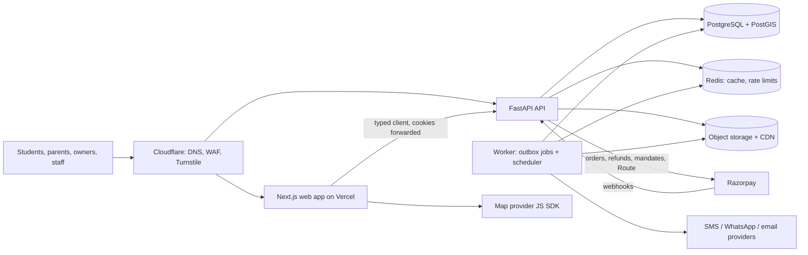

# Architecture and specs

How the platform is built. Read `PRODUCT_CONTEXT.md` first for the why. Sections 7 and 8 (booking, dynamic pricing) are the two pivots; get them right before anything fancy.

Contents
1. Principles
2. System overview
3. Stack
4. Repository layout
5. Backend design
6. Data model
7. Booking system (pivot)
8. Dynamic pricing engine (pivot)
9. Payments, refunds and ledger
10. Search, PG pages and the map
11. Visits
12. Identity and access
13. Media
14. Notifications
15. API conventions
16. Frontend architecture
17. Security
18. Scalability and performance
19. Observability
20. Testing strategy
21. Environments, CI/CD and deployment
22. Configuration and feature flags

---

## 1. Principles

- **Modular monolith, not microservices.** One API service and one worker, with strict module boundaries enforced by tooling. Modules can be split out later if a real need appears. No Kubernetes, no message broker, no event sourcing.
- **Engineered where it matters, simple elsewhere.** Money, inventory, auth and personal data get rigorous design, database-level guarantees and heavy testing. Content pages and admin screens stay plain.
- **The database guards the invariants.** Double-booking is impossible because of an exclusion constraint, not because of application code. Ledger balance and idempotency are enforced with constraints and unique keys.
- **Pure domain core.** Pricing rules, the booking state machine and money maths are pure functions with no I/O, so they are easy to test exhaustively.
- **Ports and adapters for every external service** (payments, maps, SMS, WhatsApp, email, storage), each with a dev/test adapter, so vendors can change and tests never call the internet.
- **The server is the source of truth for every price and amount.** The frontend displays quotes; it never computes money.
- **Secure by default, observable by default, 12-factor.**

## 2. System overview



- The browser talks to the web app for pages and directly to the API (same parent domain, `api.<domain>`) for client-side calls. Session cookies are scoped to the parent domain.
- The worker runs the same codebase with a different entrypoint: it processes outbox jobs and runs scheduled jobs.
- Webhooks are verified, stored and acknowledged fast, then processed by the worker.

## 3. Stack

| Layer | Choice | Why |
|---|---|---|
| API | Python 3.12+, FastAPI, Pydantic v2 | A founder already works in FastAPI; typed; OpenAPI out of the box |
| ORM / migrations | SQLAlchemy 2 (async, asyncpg), Alembic, GeoAlchemy2 | Mature, explicit transactions, PostGIS types |
| Database | PostgreSQL 16+ with `postgis`, `btree_gist`, `pg_trgm`, `citext` | Geo queries, exclusion constraints, fuzzy search in one database |
| Cache / rate limits | Redis protocol: Valkey locally, ElastiCache for Valkey expected in production (ADR 0008) | Simple, fast; nothing durable lives only in Redis |
| Jobs | Outbox table + worker using `SELECT … FOR UPDATE SKIP LOCKED`; scheduler in the worker | Jobs are enqueued in the same transaction as the change that caused them; no broker to run |
| Python tooling | uv, ruff (incl. security rules), mypy strict, import-linter, pytest, pytest-asyncio, hypothesis, testcontainers, schemathesis, polyfactory | Fast, strict, testable |
| Web | Next.js (App Router), React, TypeScript strict | SSR/ISR for SEO pages, one app for public site, owner dashboard and ops console |
| UI | Tailwind CSS, shadcn/ui (Radix primitives) | Accessible components we own |
| Client data | TanStack Query; typed client from OpenAPI (`openapi-typescript` + `openapi-fetch`) in `packages/api-client` | End-to-end types, no hand-written fetch code |
| Forms / URL state | React Hook Form + Zod; nuqs for search filters in the URL | Shareable searches, validated forms |
| Web testing | Vitest, Testing Library, MSW, Playwright, axe-core, Lighthouse CI | Unit to E2E, accessibility and performance budgets |
| Maps | Google Maps Platform via `@vis.gl/react-google-maps` behind a `MapProvider` interface; MapLibre GL + Ola Maps as the alternative adapter | See section 10 |
| Payments | Razorpay behind a `PaymentGateway` port | Orders, refunds, UPI one-time mandates, Route split settlement |
| Monitoring | Sentry (web + API), OpenTelemetry traces, structured JSON logs (structlog), product analytics (PostHog, PII masked) | |
| Hosting | Vercel (web, Mumbai functions region); AWS ap-south-1 Mumbai for API/worker (ECS Fargate), RDS PostgreSQL, Redis, S3 + CloudFront; Cloudflare DNS/WAF/Turnstile; Terraform | Low latency for Delhi users, managed services |

Use current stable versions and pin them. Verify third-party APIs against official docs at integration time.

## 4. Repository layout

```
.
├── CLAUDE.md
├── Makefile                       # one entry point for every command
├── .claude/                       # Claude Code settings, rules, skills
├── .github/workflows/             # ci.yml, security.yml, e2e.yml, deploy-*.yml
├── docs/                          # product context, architecture, build plan, adr/, runbooks/
├── infra/
│   ├── docker-compose.yml         # postgres+postgis, valkey (redis), seaweedfs (s3), mailpit
│   ├── postgres/                  # Dockerfile: PostgreSQL 18 + PostGIS 3.6 (amd64 and arm64)
│   └── terraform/                 # added in Phase 8
├── packages/
│   └── api-client/                # src/generated/ is GENERATED from OpenAPI — never edit by hand
└── apps/
    ├── api/
    │   ├── pyproject.toml  uv.lock  alembic.ini  Dockerfile  .env.example
    │   ├── migrations/
    │   ├── src/app/
    │   │   ├── main.py            # app factory
    │   │   ├── worker.py          # worker entrypoint (jobs + scheduler)
    │   │   ├── config.py          # pydantic-settings
    │   │   ├── core/              # db, redis, errors, logging, telemetry, security, idempotency,
    │   │   │                      # ratelimit, outbox, money, clock, ids, pagination, audit, flags
    │   │   └── modules/
    │   │       ├── identity/      # OTP, sessions, users, roles, consent
    │   │       ├── geo/           # cities, localities, campuses, metro stations, distances
    │   │       ├── catalog/       # owners, properties, room categories, rooms, beds, verification
    │   │       ├── media/
    │   │       ├── search/        # search, map pins, price summaries
    │   │       ├── pricing/       # domain/engine.py (pure), rules, bands, policies, quotes, calendar
    │   │       ├── visits/
    │   │       ├── booking/       # domain/state_machine.py (pure), allocations, holds, check-in, disputes
    │   │       ├── payments/      # ports.py, adapters/razorpay.py, webhooks, reconciliation, refunds
    │   │       ├── ledger/        # accounts, postings, invoices
    │   │       ├── owners/        # owner-facing APIs, agreements
    │   │       ├── ops/           # staff-facing APIs
    │   │       ├── notifications/ # ports + adapters: sms, whatsapp, email
    │   │       └── compliance/    # grievances, data requests, retention jobs
    │   └── tests/                 # unit/, integration/, contract/, load/ (k6)
    └── web/
        ├── package.json  next.config.ts  .env.example
        ├── src/app/               # routes (see section 16)
        ├── src/features/          # search, map, property, visits, booking, pricing, owner, ops
        ├── src/components/        # ui/ (shadcn), layout/, shared
        ├── src/lib/               # api client wrapper, auth, money formatting, analytics, flags
        ├── src/config/brand.ts    # the ONLY place the brand name and colours live
        └── tests/                 # unit/, e2e/
```

## 5. Backend design

### Layers inside a module
```
router.py      HTTP only: parse, authorize (via policies), call service, map errors. No business logic.
service.py     Use cases. Owns the transaction. Calls domain functions, repositories, ports, outbox.
domain/        Pure Python: entities, value objects, rules, state machines. No FastAPI, SQLAlchemy, I/O, or now().
repository.py  SQLAlchemy queries for this module's tables only.
models.py      SQLAlchemy models.   schemas.py  Pydantic request/response models (extra="forbid").
policies.py    Authorization rules: can(actor, action, resource) -> bool.
```
- Enforce with import-linter: `domain` imports nothing from `core.db`, FastAPI or other modules' repositories; modules call each other only through services or domain events.
- Cross-module side effects go through **domain events written to the outbox** in the same transaction (e.g., `booking.activated` → ledger posting and owner invoice; `pricing.rules_changed` → recompute price summaries).

### Core building blocks (`core/`)
Built in step 0.4; ADR 0010 records the design choices.
- `money.py`: paise as `int`, basis points as `int`, exact half-up rounding (ties away from zero), rounding to steps, Indian digit grouping for logs. No floats anywhere. Pure.
- `clock.py`: the injectable clock, the only code allowed to read the system time (ruff enforces); `FrozenClock` lets tests stop and move time. `calendar.py` turns moments into dates in India (pure).
- `ids.py`: internal `bigint` identity keys; public UUIDv7 `public_id` in all APIs; human booking codes (8 chars, Crockford base32, e.g. `BK-7F3K2Q9M`), normalised when typed (case, spaces, O/0, I/L/1). Pure.
- `outbox.py`: `enqueue(session, kind, payload, *, clock, run_at=None, dedupe_key=None)` in the caller's transaction. Workers claim with `FOR UPDATE SKIP LOCKED` under a lease (5 min), so a dead worker's job is taken over. A handler's work and the job's done mark commit together. Failures retry with exponential backoff and jitter (10 s doubling to 1 h) and go `dead` after `max_attempts` (10), with an error log and metrics. Done jobs are kept 7 days, dead ones 30. Every handler is idempotent.
- `scheduler.py`: periodic jobs (`Every(interval)`, `DailyAt(time)` in India time) enqueued per slot with the dedupe key `schedule:<name>:<slot>`, so any number of workers run each slot once. `app/jobs.py` lists every handler and schedule.
- `idempotency.py`: `Idempotency-Key` support built into the service's own transaction rather than middleware. The key, scope (user), route, request hash and response are stored for 24 h. A retry replays the stored response (`Idempotent-Replayed: true`), concurrent duplicates run the work once, a rollback releases the key, and the same key with a different request → 422.
- `errors.py`: RFC 9457 problem+json with a stable machine `code`.
- `ratelimit.py`: Redis sliding-window limits per IP, user, phone or route, computed atomically in Lua with the injectable clock's time. Subjects are stored only as HMAC digests. Each limit fails open or closed when Redis is down; over the limit → 429 with `Retry-After`.
- `audit.py`: append-only audit log for staff, owner and money actions, written in the action's transaction. A trigger refuses UPDATE, DELETE and TRUNCATE.
- `flags.py`: typed feature flags (`Flag`), defaults in code, overrides in `feature_flags`, cached per process for ≤ 30 s; a bad value or an unreachable database falls back to the default.
- `hashing.py`: keyed digests (HMAC with `SECRET_KEY`) for personal data that must be matched but not stored.
## 6. Data model

All tables have `id bigint generated always as identity`, `created_at`, `updated_at`; user-visible rows also have `public_id uuid unique`. Money columns end in `_paise` (`bigint`, `CHECK (>= 0)` unless noted). Rates are basis points (`_bps`). Times are `timestamptz` (UTC). Move-in/out are `date` (Asia/Kolkata).

**Identity**
- `users` (phone_e164 unique, email citext unique null, name, status), `user_roles` (user_id, role: `student | parent | owner | field_agent | ops | admin`).
- `otp_challenges` (phone_e164, code_hash, purpose, attempts, expires_at, consumed_at, ip, user_agent).
- `sessions` (user_id, token_hash, expires_at, last_seen_at, revoked_at, ip, user_agent).
- `consents` (user_id, purpose, notice_version, granted_at, withdrawn_at).

**Geo**
- `cities`, `localities` (city_id, slug, name, center geography(Point), boundary geography(Polygon) null), `campuses` (slug, name, location geography(Point)), `metro_stations` (name, line, location). Coordinates come from verified sources (OpenStreetMap with attribution); never invented.

**Catalog**
- `owners` (user_id, legal_name, business_name, gstin null, kyc_status, payout_account_ref null, agreement_version, status).
- `owner_agreements` (owner_id, version, document_sha256, accepted_at, accepted_ip, accepted_user_agent).
- `properties` (owner_id, slug, name, description, address_line, locality_id, `location geography(Point,4326)` exact, `display_location geography(Point,4326)` public, `location_precision: exact | approximate`, gender_policy: `boys | girls | coed`, meals: `none | breakfast | two | three | four`, house_rules, verification_status: `unverified | scheduled | verified | rejected | suspended`, licence_status: `unknown | applied | licensed | not_required`, licence_number null, society_permission: `n/a | on_file | missing`, instant_confirm bool, status: `draft | published | paused | delisted`).
- `room_categories` — **the sellable unit and the pricing unit** (property_id, occupancy: `single | double | triple | quad`, ac bool, attached_bath bool, balcony bool, label, `base_rent_paise` (listed rent per bed per month), `owner_min_rent_paise` null, `owner_max_rent_paise` null, security_deposit_paise, mandatory_charges jsonb (e.g. electricity per unit and a monthly estimate), status).
- `rooms` (room_category_id, label, floor), `beds` (room_id, label, status: `active | inactive`).
- `amenities`, `property_amenities`; `verification_reports` (property_id, agent_id, visited_at, gps geography(Point), checklist jsonb, result, notes).

**Inventory**
```sql
CREATE TABLE inventory_allocations (
  id          bigint GENERATED ALWAYS AS IDENTITY PRIMARY KEY,
  bed_id      bigint NOT NULL REFERENCES beds(id),
  period      daterange NOT NULL,            -- [move_in, move_out)
  kind        text NOT NULL CHECK (kind IN ('booking','offline_tenant','maintenance')),
  booking_id  bigint NULL REFERENCES bookings(id),
  is_active   boolean NOT NULL DEFAULT true,
  created_by  bigint NULL REFERENCES users(id),
  created_at  timestamptz NOT NULL DEFAULT now(),
  CHECK (NOT isempty(period)),
  CHECK ((kind = 'booking') = (booking_id IS NOT NULL)),
  EXCLUDE USING gist (bed_id WITH =, period WITH &&) WHERE (is_active)
);
```
This constraint is the double-booking guarantee. Never work around it.

**Pricing**
- `fee_policies` (rate_bps = 3000, basis = `listed_rent`, gst_rate_bps = 1800, gst_mode: `exclusive | inclusive`, effective_from, effective_to).
- `booking_policies` (token_paise = 200000, hold_minutes = 15, free_cancel_days = 7, check_window_hours = 24, confirm_deadline_hours = 12, no_show_days = 3, late_cancel_policy: `refund_full | forfeit_to_owner | split`, max_active_holds_per_user = 1, max_advance_days = 120).
- `pricing_caps` (max_premium_bps = 4000, max_discount_bps = 3000, rounding_step_paise = 5000).
- `rent_bands` (locality_id, occupancy, min_rent_paise, max_rent_paise, source: `official | internal`, reference, effective_from, effective_to).
- `pricing_rule_sets` (property_id, version int, status: `draft | active | archived`, created_by, activated_at); unique (property_id) where status = 'active'. Active and archived sets are immutable.
- `pricing_rules` (rule_set_id, kind, room_category_ids bigint[] null (= all), params jsonb validated per kind, label shown to students, enabled).
- `price_quotes` (public_id, user_id null, room_category_id, move_in, stay_months, base_rent_paise, monthly_rent_paise, adjustments jsonb, clamps jsonb, fee_paise, gst_paise, owner_fee_total_paise, token_paise, due_at_move_in_paise, deposit_paise, mandatory_charges jsonb, rule_set_id, fee_policy_id, rent_band_id null, engine_version, inputs_sha256, expires_at).
- `property_price_summaries` (property_id, room_category_id, month date, min_rent_paise, max_rent_paise, available_beds, computed_at) — feeds search and the map.

**Visits and booking**
- `visits` (public_id, property_id, student_id, preferred_slots tstzrange[], scheduled_slot tstzrange null, status: `requested | scheduled | completed | no_show | cancelled`, agent_id null, agent_checkin_at, agent_checkin_gps, outcome, booking_id null).
- `bookings` (public_id, code unique, student_id, property_id, room_category_id, bed_id, owner_id, quote_id, channel: `on_spot | remote`, visit_id null, move_in, stay_months, planned_move_out, status, hold_expires_at, confirmed_at, checked_in_at, check_window_ends_at, activated_at, cancelled_at, cancelled_by, cancellation_kind, completed_at, monthly_rent_paise, fee_paise, gst_paise, owner_fee_total_paise, token_paise, due_at_move_in_paise, version int).
- `booking_events` (booking_id, event, from_status, to_status, actor_type, actor_id, payload jsonb) — append-only; powers the student timeline and audits.
- `disputes` (booking_id, reason: `not_as_shown | unsafe | other`, description, media_ids, status: `open | resolved_refund | resolved_uphold`, resolved_by, resolved_at, notes).

**Payments and ledger**
- `payments` (public_id, booking_id, purpose: `token | rent | owner_invoice`, mode: `payment | upi_mandate`, provider, provider_order_id, provider_payment_id, provider_mandate_id, amount_paise, status, idempotency_key unique).
- `payment_events` (provider, provider_event_id, event_type, payload jsonb, signature_valid, received_at, processed_at, error) — **unique (provider, provider_event_id)**.
- `refunds` (payment_id, amount_paise, reason, provider_refund_id, status, requested_by, approved_by).
- `ledger_accounts` (code, name, type: `asset | liability | revenue | expense`), `ledger_transactions` (kind, booking_id, payment_id, memo), `ledger_entries` (transaction_id, account_id, direction: `debit | credit`, amount_paise > 0). Sum of debits = sum of credits per transaction, enforced by a deferred constraint trigger and tests.
- `owner_invoices` (owner_id, booking_id, invoice_number unique per financial year, fee_paise, gst_paise, total_paise, token_applied_paise, balance_due_paise, status: `draft | issued | paid | void`, issued_at, pdf_key).

**Platform**
- `outbox_jobs`, `idempotency_keys`, `audit_logs` (append-only; the app's DB role has no UPDATE/DELETE on it), `feature_flags`, `notifications`, `grievances` (ticket number, acknowledged_at, resolved_at), `data_requests` (export/delete under DPDP).

**Indexes to create from day one**: GiST on `properties.location` and `display_location`; GiST exclusion index above; trigram GIN on `properties.name` and `localities.name`; btree on every FK; partial index on `bookings (status, hold_expires_at) WHERE status = 'HELD'`; `outbox_jobs (status, run_at)`; BRIN on `booking_events.created_at` and `audit_logs.created_at`.

## 7. Booking system (pivot)

### 7.1 Flow
1. Student picks a room category and move-in date on a PG page; the web app requests a **quote**.
2. Student taps Reserve → `POST /v1/bookings` with `quote_id` and an `Idempotency-Key`. The API creates a **HELD** booking, allocates a free bed, and returns the payment step.
3. Student secures the token (payment or UPI block). The verified gateway event moves the booking to **TOKEN_SECURED**.
4. Owner or ops confirm (or the property auto-confirms) → **CONFIRMED**. The student now sees the exact address and move-in instructions.
5. On move-in the student taps "I've moved in" → **CHECKED_IN**, starting the 24-hour check window.
6. No dispute within the window → **ACTIVE**: the token is earned, the owner invoice is issued, ledger entries are posted.
7. At move-out → **COMPLETED**.

The same flow serves both channels: `on_spot` (student at the property with an agent, usually instant-confirm) and `remote` (behind the flag `remote_booking_enabled`).

### 7.2 State machine
Implemented as a pure transition table in `booking/domain/state_machine.py`. Services call `transition(booking, event, actor, now) -> (new_state, side_effects)` and persist with a compare-and-set update (`UPDATE … WHERE id = :id AND status = :expected AND version = :v`).

| From | Event | To | Actor | Guard | Side effects |
|---|---|---|---|---|---|
| — | `hold` | HELD | student | valid unexpired quote owned by user; bed free; active holds < limit; move_in within limits | allocation active; `hold_expires_at = now + hold_minutes`; create order or mandate request |
| HELD | `token_secured` | TOKEN_SECURED | system | verified gateway event; amount = quote token | ledger: token received; notify owner and ops; auto-`confirm` if `instant_confirm` |
| HELD | `hold_expired` | EXPIRED | system | now ≥ hold_expires_at | deactivate allocation; cancel order/mandate |
| HELD | `cancel` | CANCELLED | student | — | deactivate allocation |
| TOKEN_SECURED | `confirm` | CONFIRMED | owner, ops | — | notify student with exact address and move-in details |
| TOKEN_SECURED | `reject`, `confirm_timeout` | REJECTED | owner, ops, system | — | deactivate; full refund/release; suggest similar PGs |
| TOKEN_SECURED | `cancel` | CANCELLED | student | — (not yet confirmed) | deactivate; full refund/release |
| CONFIRMED | `cancel` | CANCELLED | student | today ≤ move_in − free_cancel_days | deactivate; full refund/release |
| CONFIRMED | `cancel_late` | CANCELLED | student | inside the cutoff | deactivate; apply `late_cancel_policy` |
| TOKEN_SECURED, CONFIRMED | `owner_cancel` | CANCELLED | owner, ops | — | deactivate; full refund/release; flag owner; rebooking help |
| CONFIRMED | `check_in` | CHECKED_IN | student; or ops, then student confirms | today ≥ move_in − 1 | `check_window_ends_at = now + check_window_hours` |
| CONFIRMED | `no_show` | NO_SHOW | system | today > move_in + no_show_days | deactivate; apply `late_cancel_policy` |
| CHECKED_IN | `dispute` | DISPUTED | student | now < check_window_ends_at | open dispute with photos; alert ops |
| CHECKED_IN | `window_elapsed` | ACTIVE | system | now ≥ check_window_ends_at | earn/capture token; issue owner invoice; ledger postings |
| DISPUTED | `resolve_refund` | REFUNDED | ops | — | deactivate; full refund/release; rebooking help |
| DISPUTED | `resolve_uphold` | ACTIVE | ops | — | as `window_elapsed` |
| ACTIVE | `move_out` | COMPLETED | owner, ops, student | — | truncate allocation period to the move-out date |

Allocation is active in HELD, TOKEN_SECURED, CONFIRMED, CHECKED_IN, DISPUTED, ACTIVE and COMPLETED (truncated). Every transition writes a `booking_events` row and an audit entry. Test every allowed transition and assert every other (state, event) pair is rejected.

### 7.3 Holding a bed without race conditions
Inside one transaction:
1. `SELECT b.id FROM beds b JOIN rooms r ON r.id = b.room_id WHERE r.room_category_id = :c AND b.status = 'active' FOR UPDATE OF b` (serialises attempts per category).
2. Expire stale holds for these beds: set HELD bookings past `hold_expires_at` to EXPIRED and deactivate their allocations.
3. Choose a bed with no active allocation overlapping `[move_in, planned_move_out)`. Prefer beds in partly occupied rooms, so whole rooms stay free for groups.
4. Insert the booking (HELD) and the allocation. If the exclusion constraint fires anyway, return `409 BED_UNAVAILABLE`.

Required test: 50 concurrent hold requests for the last free bed → exactly one HELD booking, 49 × 409, no overlapping active allocations.

### 7.4 Edge cases (must be handled and tested)
- **Payment after the hold expired**: if the bed is still free, re-allocate and move to TOKEN_SECURED (`late_payment_revive`); otherwise refund automatically and notify the student with alternatives.
- **Duplicate or out-of-order webhooks**: processing is idempotent per `provider_event_id` and per payment status; states only move forward.
- **Quote expired at hold time**: `409 QUOTE_EXPIRED`; the client re-quotes and shows any price change before retrying.
- **Owner marks a bed occupied offline** while a hold exists: the offline block insert fails with the constraint; the owner sees which booking holds the bed.
- **Move-in beyond mandate validity** (UPI mode): use payment mode or ask the student to book closer to move-in.
- **Stay extension**: update the allocation's upper bound in a transaction (the constraint re-checks).

### 7.5 Scheduled jobs (worker)
| Job | Every | Does |
|---|---|---|
| expire_holds | 1 min | HELD past expiry → EXPIRED |
| confirm_timeouts | 5 min | TOKEN_SECURED past the deadline → REJECTED + refund |
| check_windows | 5 min | CHECKED_IN past the window → ACTIVE |
| no_shows | daily 10:00 IST | CONFIRMED past move_in + N days → NO_SHOW |
| reconcile_payments | 15 min | Fetch status of payments stuck in created/authorized |
| recompute_price_summaries | on event + nightly | Refresh `property_price_summaries` |
| retention | daily | Delete or anonymise data past its retention period |

All jobs are idempotent and emit metrics (processed, failed, lag).

## 8. Dynamic pricing engine (pivot)

### 8.1 Contract
`pricing/domain/engine.py` exposes one pure function:
```python
def quote(ctx: PricingContext) -> QuoteResult: ...
```
`PricingContext` holds: room category (base rent, owner min/max, occupancy type), property, move_in, stay_months, today, occupancy for the category on move_in (from real allocations), the active rule set, rent band (optional), fee policy, booking policy, pricing caps and `engine_version`. No I/O and no clock reads inside the engine.

### 8.2 Rule kinds (v1, set by owners/ops by hand)
| Kind | Params (validated per kind) | Effect |
|---|---|---|
| `season` | start_md, end_md (MM-DD, may wrap the year), bps | + or − bps when move_in falls in the range; seasons may not overlap for the same categories |
| `occupancy` | tiers: [{min_occupancy_bps, bps}] | Premium from the highest tier reached. Occupancy counts beds in TOKEN_SECURED or later plus offline tenants; **HELD beds don't count**, so holds can't inflate prices |
| `early_bird` | min_days_before, bps (negative) | Discount when booked far enough ahead |
| `last_minute` | max_days_before, max_occupancy_bps, bps (negative) | Discount close to move-in when occupancy is low |
| `length_of_stay` | tiers: [{min_months, bps (negative)}] | Discount from the highest tier reached |
| `override` | start, end, rent_paise | Fixed monthly rent for move-ins in range; skips other rules, still clamped |

Each rule has a `label` shown to students ("Peak season", "Early-bird").

### 8.3 Algorithm
```
base = category.base_rent_paise
if an override matches move_in:
    candidate = override.rent_paise; adjustments = [override]
else:
    premium  = min(sum of positive bps from matching rules, caps.max_premium_bps)
    discount = min(sum of |negative| bps from matching rules, caps.max_discount_bps)
    candidate = base * (10_000 + premium - discount) / 10_000        # integer maths, half-up
lo = max(owner_min or 0, band.min or 0); hi = min(owner_max or ∞, band.max or ∞)
if lo > hi: raise PricingConfigError  # surface to ops; never quote
price = round_to_step(clamp(candidate, lo, hi), step)  # then re-snap inside [lo, hi]
fee   = round_half_up(base * fee_policy.rate_bps / 10_000)            # ALWAYS on base
if gst_mode == exclusive: gst = round_half_up(fee * gst_rate_bps / 10_000); owner_total = fee + gst
else: owner_total = fee; net = round_half_up(fee * 10_000 / (10_000 + gst_rate_bps)); gst = fee - net
token = min(booking_policy.token_paise, price)
due_at_move_in = price - token
```
Worked example (₹10,000 base, July move-in, +15% season, −5% early-bird, 11-month stay −7%): premium 1,500, discount 1,200 → ₹10,300 → rounded to ₹10,300 (step ₹50) → fee ₹3,000, GST ₹540, owner total ₹3,540, token ₹2,000, due at move-in ₹8,300.

### 8.4 Quotes and the price lock
- `POST /v1/quotes` runs the engine and stores a `price_quotes` row (valid 30 minutes) with the full breakdown, versions and an `inputs_sha256`.
- Bookings copy the quote's money fields; that monthly rent holds for the whole stay. Rule changes create a new rule-set version and never touch existing quotes or bookings.
- The response includes a human explanation: "Base ₹10,000 · Peak season +15% · Early-bird −5% · 11-month stay −7% = ₹10,300/month, fixed for your stay".

### 8.5 Price calendar and honest urgency
- `GET /v1/properties/{id}/price-calendar?category=…&from=…&weeks=12` runs the engine for weekly move-in dates and returns rent per week (cached five minutes).
- The PG page shows "Move in by 15 Jun: ₹9,500 · from 1 Jul: ₹11,000". Text like "price rises on 1 Jul" is allowed only because the calendar proves it.
- "Only N beds left" appears only when real availability for the chosen dates is ≤ 3.
- No countdown timers except the real hold expiry during checkout.

### 8.6 Owner and ops pricing editor
- Edit a draft rule set, see validation errors (overlapping seasons, a band conflict, caps), preview any move-in date and stay with the full breakdown, see a 12-week price chart, then activate. Activation creates an immutable version and is audit-logged.
- Show the locality band and the market median next to the inputs.

### 8.7 Integrity guards
- The listed rent must be the price charged when no rule applies. Alert ops when it is more than 25% below the locality median for the same occupancy type, or when clamps trigger on more than 20% of quotes in a week.
- Caps and bands are admin-only settings.

### 8.8 Invariants (property-based tests with Hypothesis, ≥ 10,000 generated cases in CI)
- `fee` depends only on base rent and fee policy, never on rules, occupancy or dates.
- `price` stays within [lo, hi] whenever lo ≤ hi, and is a multiple of the rounding step (unless the bounds force otherwise).
- Total premium ≤ cap and total discount ≤ cap.
- Early-bird, last-minute and length-of-stay rules never raise a price; occupancy premiums apply only at or above their threshold.
- Same inputs → same output; all amounts are non-negative integers; `due_at_move_in + token = price`.

### 8.9 Later (Phase 9, after a season of data)
Suggested prices for owners from demand signals: PG page views, visit requests and conversion per locality and week, occupancy pace against last year, and the calendar. Owners approve every suggestion; nothing changes prices automatically.

## 9. Payments, refunds and ledger

### 9.1 Port
```python
class PaymentGateway(Protocol):
    async def create_order(self, *, amount_paise: int, receipt: str, notes: dict[str, str]) -> Order: ...
    def verify_checkout_signature(self, *, order_id: str, payment_id: str, signature: str) -> bool: ...
    def verify_webhook(self, *, raw_body: bytes, signature: str) -> bool: ...
    async def fetch_payment(self, payment_id: str) -> PaymentStatus: ...
    async def refund(self, *, payment_id: str, amount_paise: int, idempotency_key: str) -> Refund: ...
    # capability: UPI one-time mandate (token block)
    async def create_mandate(self, *, amount_paise: int, expires_at: datetime, ...) -> Mandate: ...
    async def capture_mandate(self, mandate_id: str, amount_paise: int) -> Capture: ...
    async def release_mandate(self, mandate_id: str) -> None: ...
    # capability: split settlement (Razorpay Route), Phase 9
    async def transfer(self, *, payment_id: str, account_ref: str, amount_paise: int, on_hold: bool) -> Transfer: ...
    async def release_transfer(self, transfer_id: str) -> None: ...
```
Adapters: `RazorpayGateway` and `FakeGateway` (deterministic, used in tests and local dev, can emit signed webhook fixtures).

### 9.2 Token modes (`token_mode` flag)
- `payment` (v1 default): server creates an order for exactly `quote.token_paise`; Razorpay Checkout on the web; the server verifies the checkout signature, but **only the verified webhook or a server-side fetch moves the booking**. Refund on cancel, reject, timeout or dispute.
- `upi_mandate` (after Razorpay enables one-time mandates for us): authorise a block for the token; capture on ACTIVE; release on refund paths. Validity must cover move_in + check window.
- `rent_via_app` (Phase 9): the student pays the rest of the first month through the app; Route transfers `rent − owner_fee_total` to the owner's linked account.

Verify Razorpay's current docs for order creation, checkout signature format, webhook headers and event names, OTM and Route before writing the adapter.

### 9.3 Webhooks
`POST /v1/webhooks/razorpay`: read the raw body → verify HMAC with the webhook secret → insert into `payment_events` (unique provider event id; a duplicate returns 200 and stops) → enqueue `process_payment_event` → return 200 within 1 s. The worker maps events to payment status changes and booking transitions, idempotently. Unknown events are stored and ignored.

### 9.4 Ledger
Chart of accounts (seeded): `gateway_clearing` (asset), `bank` (asset), `owner_receivable` (asset), `student_tokens_held` (liability), `owner_payable` (liability, Phase 9), `gst_payable` (liability), `placement_fee_revenue` (revenue), `payment_fees` (expense).

| Event | Debit | Credit |
|---|---|---|
| Token captured | gateway_clearing 2,000 | student_tokens_held 2,000 |
| Token refunded | student_tokens_held 2,000 | gateway_clearing 2,000 |
| Booking ACTIVE: invoice owner | owner_receivable 3,540 | placement_fee_revenue 3,000; gst_payable 540 |
| Booking ACTIVE: apply token | student_tokens_held 2,000 | owner_receivable 2,000 |
| Owner pays the balance | gateway_clearing 1,540 | owner_receivable 1,540 |
| Gateway fee | payment_fees | gateway_clearing |
| Settlement to bank | bank | gateway_clearing |

Amounts shown in rupees for the ₹10,000 example. Every money-moving use case posts its entries in the same transaction as the state change. The accounting treatment must be confirmed with a CA; the ledger design supports changes.

### 9.5 Owner invoices
Issued on ACTIVE: fee, GST, token applied, balance due; sequential invoice numbers per financial year (`FY2027-28/000123`); a PDF stored privately; balance collected through a Razorpay payment link and marked paid by webhook.

### 9.6 Reconciliation
Every 15 minutes, check payments stuck in created/authorized. Daily, match gateway settlement reports against the ledger; any mismatch raises an alert and a ticket. A reconciliation dashboard is part of the ops console.

## 10. Search, PG pages and the map

### 10.1 Search API
`GET /v1/search/properties` with: `campus` + `radius_m` or `locality` or `bbox`; `move_in_month`; `budget_min`/`budget_max` (against `property_price_summaries` for that month); `gender`; `occupancy`; `meals`; `ac`; `attached_bath`; `amenities[]`; `verified_only` (default true); `available` (beds free for the month); `q` (trigram + full-text on name and locality); `sort`: `recommended | price_asc | price_desc | distance | newest`; cursor pagination (max 50). Returns cards: name, locality, display location, distance to the chosen campus and nearest metro, price range for the month, badges (verified, licensed, meals), cover photo variants, beds-available bucket.

### 10.2 Map pins API
`GET /v1/map/pins?bbox=w,s,e,n&zoom=&…same filters` → up to 2,000 compact pins `{id, lat, lng, minRent, maxRent, gender, verified, availability}` using `display_location`. Cached in Redis by rounded bbox, zoom and a filter hash (60 s), with ETags. Clustering happens on the client.

### 10.3 The map experience (showcase)
- **Price pins** like "₹8k–12k" (verified PGs get a badge); clusters show the count and the lowest price.
- Desktop split view (list + map); mobile shows the list first with a map toggle and a draggable bottom sheet.
- "Search as I move the map": debounce 300 ms, cancel stale requests, keep results in the URL so searches are shareable.
- Hovering a card highlights its pin and vice versa; selecting a pin opens a preview card.
- Overlays: campuses with 1 km and 2 km rings, metro stations, the selected locality's outline.
- The map is locked to Delhi NCR bounds and zoom levels.
- Keyboard and screen reader users get the same results through the list; pins are focusable.
- Load the map SDK lazily, only when the map view is opened.

### 10.4 Provider choice
- Default: **Google Maps Platform** (strongest India map data). Google announced India pricing up to 70% lower and up to US$6,800 a month of free usage across products from March 2025, with Maps Embed API usage free and unlimited ([Google, Dec 2024](https://blog.google/intl/en-in/products/explore-communicate/helping-developers-in-india-build-more-with-google-maps-platform/)). Use the JS API only on the search map, and the free Embed API for the small map on PG pages.
- Alternative adapter: **MapLibre GL + Ola Maps** tiles: 100,000 free map loads a month, then ₹0.141 per load, from 1 September 2026 ([Ola Maps pricing](https://maps.olakrutrim.com/pricing)). Check MapLibre compatibility in their docs.
- Prefer providers that show India's official boundaries; the NCR lock keeps country borders off-screen anyway.
- Re-check prices and quotas before launch and set budget alerts in the provider console.

### 10.5 Location privacy
- `display_location` is the exact point shifted by a random bearing and 80–150 m, generated once and stored (regenerated only if the exact point changes), so repeated requests can't be averaged to find the building.
- The exact address and pin are shown only after a visit is scheduled or a booking is confirmed (flag `hide_owner_contact`).
- Field agents capture the exact location by GPS during verification; ops can adjust the pin manually.

### 10.6 PG page and SEO
- `/pg/[slug]` (ISR): gallery with "verified photo" labels, video tour, safety checklist summary, room categories with live prices for the chosen month, price calendar, amenities, house rules, deposit and mandatory charges, distance to campuses and metro, owner business name, reviews (later), "Book a visit" and "Reserve a bed" CTAs.
- Landing pages: `/pg-near/[campus]`, `/pg-in/[locality]` with real inventory, filters and FAQs.
- JSON-LD (`LodgingBusiness` with `Offer` price ranges), canonical URLs, `sitemap.xml`, `robots.txt`, dynamic Open Graph images. The API triggers on-demand revalidation when a listing or its prices change.

## 11. Visits

- Student requests a visit with up to three preferred slots; ops schedule it and assign an agent; SMS/WhatsApp confirmation and reminders at T−24 h and T−2 h.
- The agent checks in at the property from their phone (timestamp + GPS). That **visit log** proves we introduced the student (leakage defence).
- After the visit the agent records the outcome. If the student wants the bed, the agent opens **Reserve now** on the student's phone (channel `on_spot`) — quote → hold → token.
- Limits: at most 5 open visit requests per student; rate limits on creation.

## 12. Identity and access

- **Students, parents, owners**: phone OTP. Six digits, stored as an HMAC with a server pepper, five-minute expiry, five attempts, 30-second resend cooldown, at most five sends per phone per hour and per IP limits, Cloudflare Turnstile before sending. Phone numbers normalised to E.164 (+91). SMS through a DLT-registered template behind an `OtpSender` port (console adapter in dev).
- **Staff (ops, admin, field agents)**: Google Workspace sign-in (OIDC) restricted to the company domain with 2-step verification enforced, or OTP + TOTP until the domain exists. Shorter sessions (12 h).
- **Sessions**: opaque 256-bit tokens; only a hash stored server-side; `HttpOnly; Secure; SameSite=Lax` cookie on the parent domain; 30-day sliding expiry for users; rotate on login and role change; logout and "log out everywhere"; session list in the profile.
- **CSRF**: SameSite=Lax plus a double-submit CSRF token header on every state-changing request. CORS allowlist of exact origins.
- **Authorization**: deny by default; role checks plus object-level policies (an owner only sees their properties and their bookings; a student only their visits and bookings). Return 404 for another user's resources. Maintain an authorization matrix test that covers every endpoint × role.
- **Parents**: a signed, expiring, read-only share link for a PG and a booking; a parent can pay the token from the link without an account (Phase 9).
- **Consent (DPDP)**: versioned privacy notice accepted at signup and stored in `consents`; endpoints for data export and deletion requests; retention schedule enforced by a job.

## 13. Media

- Direct-to-storage uploads with presigned URLs: content-type allowlist (JPEG, PNG, WebP, HEIC, MP4), size limits (photos 15 MB, video 200 MB), no SVG.
- The worker validates magic bytes, **strips EXIF including GPS**, creates WebP/AVIF variants (thumb, card, gallery, full) and marks moderation status. Video: create a poster image and enforce duration limits (transcoding can come later).
- Public listing media are served through the CDN; private files (KYC, agreements, invoices, dispute photos) use short-lived signed URLs.
- `verified_capture = true` marks photos taken by a field agent, shown as "Verified photo · 12 Jun 2027".

## 14. Notifications

- Ports: `SmsSender`, `WhatsAppSender` (later, through a BSP), `EmailSender`; dev adapters log to the console or Mailpit.
- Sent from outbox jobs, with a dedupe key per (event, recipient, channel). Templates are versioned and DLT-approved for SMS.
- Key messages: OTP, visit scheduled/reminder, booking held/secured/confirmed/rejected, check-in window started/ended, refund issued, owner new-booking alert, owner confirm reminder, invoice issued.

## 15. API conventions

- REST over JSON at `/v1`; plural nouns; JSON fields in camelCase (Pydantic alias generator), Python in snake_case.
- Errors: RFC 9457 problem+json `{type, title, status, detail, code, errors[], requestId, traceId}` (`app/core/errors.py`, ADR 0009). Each `errors[]` item is `{detail, code, pointer}` for a body field (JSON Pointer, e.g. `/moveIn`) or `{detail, code, parameter}` for a query, path or header parameter. Rejected input is never echoed back, and unexpected errors never reveal their message. Stable codes, e.g. `BED_UNAVAILABLE`, `QUOTE_EXPIRED`, `HOLD_LIMIT_REACHED`, `INVALID_TRANSITION`, `OTP_INVALID`, `OTP_LOCKED`, `RATE_LIMITED`, `PRICING_CONFIG_ERROR`. Generic codes: `VALIDATION_ERROR` (422), `BAD_REQUEST`, `UNAUTHENTICATED`, `FORBIDDEN`, `NOT_FOUND`, `METHOD_NOT_ALLOWED`, `NOT_ACCEPTABLE`, `CONFLICT`, `PAYLOAD_TOO_LARGE` (bodies over 1 MiB), `UNSUPPORTED_MEDIA_TYPE`, `SERVICE_UNAVAILABLE`, `INTERNAL_ERROR`, and `HTTP_ERROR` for any other status. Idempotency: `IDEMPOTENCY_KEY_REQUIRED` and `IDEMPOTENCY_KEY_INVALID` (400), `IDEMPOTENCY_KEY_REUSED` (422), `IDEMPOTENCY_KEY_CONFLICT` (409).
- Probes: `GET /healthz` (liveness) and `GET /readyz` (database and Redis reachable, 503 otherwise) sit outside `/v1`, need no authentication, and are left out of tracing and info-level access logs.
- Money: integer paise with names ending in `Paise`; the client formats with `Intl.NumberFormat('en-IN', { style: 'currency', currency: 'INR' })`.
- Dates: `YYYY-MM-DD` for move-in; timestamps in ISO 8601 UTC; display in IST.
- Public ids only (UUIDv7, booking codes). Never expose sequential ids.
- Cursor pagination (`cursor`, `limit` ≤ 50).
- `Idempotency-Key` is required on POSTs that create bookings, payments, refunds or invoices.
- OpenAPI is the contract: CI regenerates the TS client and fails if it is stale; `oasdiff` fails CI on breaking changes.

Main endpoints (v1):
```
Public   GET  /v1/cities /v1/localities /v1/campuses
         GET  /v1/search/properties    GET /v1/map/pins
         GET  /v1/properties/{slug}    GET /v1/properties/{id}/price-calendar
         POST /v1/quotes               GET /v1/quotes/{id}
Auth     POST /v1/auth/otp/request     POST /v1/auth/otp/verify   POST /v1/auth/logout   GET /v1/me
Student  POST/GET /v1/visits           POST /v1/visits/{id}/cancel
         POST /v1/bookings             GET /v1/bookings   GET /v1/bookings/{code}
         POST /v1/bookings/{code}/cancel | /check-in | /disputes
         POST /v1/payments/{id}/checkout-callback
Webhooks POST /v1/webhooks/razorpay
Owner    /v1/owner/properties… /v1/owner/beds/{id}/blocks /v1/owner/pricing/rule-sets… (+ /preview, /activate)
         /v1/owner/bookings/{code}/confirm | /reject   /v1/owner/invoices
Ops      /v1/ops/properties… /v1/ops/verification… /v1/ops/visits… /v1/ops/bookings…
         /v1/ops/disputes… /v1/ops/refunds… /v1/ops/reconciliation
Admin    /v1/admin/rent-bands /v1/admin/policies /v1/admin/flags /v1/admin/audit-logs
Compliance POST /v1/grievances  POST /v1/data-requests
```

## 16. Frontend architecture

- Route groups: `(marketing)` home, about, pricing, contact, legal pages; `(discover)` `/search`, `/pg/[slug]`, `/pg-near/[campus]`, `/pg-in/[locality]`; `(account)` login, profile; `(student)` `/visits`, `/bookings/[code]`; `/owner/*` dashboard; `/ops/*` console. Owner, ops and account routes are `noindex` and protected in middleware **and** on the server.
- Server Components by default; Client Components for the map, filters, booking flow and editors.
- Data: server-side calls through the typed client with cookies forwarded; client-side through TanStack Query with conventional query keys; no ad-hoc `fetch`.
- The URL is the source of truth for search state (nuqs). Minimal global state.
- `MapProvider` interface: `<MapView pins onBoundsChange onPinSelect selectedId overlays bounds />` with `GoogleMapView` and `MapLibreMapView` adapters.
- Feature folders own their components, hooks and tests; enforce boundaries with ESLint rules.
- Performance: dynamic import of the map; `next/image` with CDN variants; `next/font`; route-level code splitting; budget on mid-range Android over 4G of LCP < 2.5 s, INP < 200 ms, CLS < 0.1, initial JS < 200 KB gzip on PG pages.
- PWA: manifest, icons, a service worker for the app shell and the shortlist; never cache authenticated API responses.
- Accessibility: WCAG 2.2 AA; Radix primitives; visible focus; labels; colour contrast; axe checks in CI.
- i18n-ready from day one (strings in message files; English first, Hindi later).
- Brand name, colours and logo only in `src/config/brand.ts`.

## 17. Security

Target OWASP ASVS level 2 for auth, booking, payments and personal data.

- **Input**: Pydantic and Zod validation; `extra="forbid"`; request size limits; server computes all money; quotes are server-side records, not client payloads.
- **Auth**: as section 12. Lock out after repeated OTP failures; alert on spikes.
- **Authorization**: policies on every endpoint; 404 for others' resources; the authorization matrix test must pass in CI.
- **Headers**: strict CSP with nonces (no `unsafe-inline` scripts), HSTS, `X-Content-Type-Options: nosniff`, `Referrer-Policy: strict-origin-when-cross-origin`, `frame-ancestors 'none'`, a tight `Permissions-Policy` (geolocation only on self, for "near me").
- **Payments**: never handle card data; amounts computed server-side; checkout signature verified; webhooks verified on the raw body; idempotent processing; refunds require the ops role, a reason and an audit entry; two-person approval for manual refunds above ₹5,000 (configurable).
- **Rate limits and abuse**: OTP, login, visit and booking creation, search and map endpoints; at most one active hold per user; Cloudflare WAF rules on auth routes; bot protection on public search to slow scraping.
- **Secrets**: environment variables loaded from AWS Secrets Manager / Vercel env; separate test and live keys; rotation documented; gitleaks in pre-commit and CI; nothing secret in `NEXT_PUBLIC_*`; Claude Code is denied read access to `.env` files.
- **Data protection**: managed encryption at rest; application-level envelope encryption for KYC fields and documents; minimal PII; mask phone numbers in logs (show the last 4 digits); no Aadhaar numbers; retention schedule; breach response runbook (DPDP).
- **Files**: see section 13 (presigned uploads, EXIF stripping, private buckets, no SVG).
- **Supply chain**: lockfiles; Renovate or Dependabot; pip-audit and pnpm audit; CodeQL; Trivy on images; GitHub Actions pinned by commit SHA; least-privilege tokens; OIDC from CI to AWS (no long-lived keys).
- **Infrastructure**: no public database endpoint; least-privilege security groups and IAM; separate AWS accounts or projects for staging and production; automated backups with point-in-time recovery and a tested restore.
- **Audit**: append-only audit log for staff, owner and money actions; the app's DB role can't modify it.
- **Testing**: OWASP ZAP baseline on staging, Schemathesis fuzzing from the OpenAPI schema, a STRIDE threat model per phase that touches auth or money, and an external penetration test before scaling beyond the first micro-market.

## 18. Scalability and performance

- Planning load for peak season: 100,000 monthly users, 300 requests/s peak reads (search, map, PG pages), 20 requests/s writes, 50 concurrent hold attempts on one popular PG. Design for 10× by scaling horizontally.
- Stateless API and worker containers with autoscaling on CPU and latency; DB connection pooling (sized pools, RDS Proxy or PgBouncer when needed); a read replica for search when required.
- Caching: Redis for map pins, search results and price calendars with event-based invalidation; CDN for media and static assets; ISR for PG and landing pages.
- Precompute `property_price_summaries` so search and map never run the pricing engine per request.
- Query discipline: every list endpoint paginated; N+1 checks in tests (a query-count assertion helper); `EXPLAIN ANALYZE` on the top queries before launch.
- City as a first-class dimension (cities → localities → bands → policies) so Gurugram, Noida and later Bengaluru or Pune are configuration, not code.
- SLOs: p95 < 300 ms for search and map pins, < 400 ms for quote and hold (gateway time excluded), 99.9% monthly availability in June–August; zero double bookings.
- Load tests with k6 before every peak season and before major releases.

## 19. Observability

- Structured JSON logs with request id, user id (internal), route and latency; no PII; phone numbers masked.
- OpenTelemetry tracing across FastAPI, SQLAlchemy and httpx, exported to the chosen backend; trace ids returned in error responses.
- Metrics: bookings by state and transitions per hour, hold expiry rate, quote-to-hold and hold-to-secured conversion, webhook lag, outbox lag and dead jobs, reconciliation mismatches, OTP send failures, p95 latency per route, error rate.
- Sentry for web and API, with release tracking and source maps.
- Alerts: dead outbox jobs, webhook failures, reconciliation mismatch, error-rate spike, OTP provider failure, constraint violations above baseline, refund stuck > 24 h.
- Runbooks in `docs/runbooks/` for each alert.

## 20. Testing strategy

| Level | Tools | Must cover |
|---|---|---|
| Unit (pure domain) | pytest, Hypothesis | Pricing engine invariants; state machine (every pair); money maths; policies |
| Integration | pytest + testcontainers (PostGIS image) | Repositories, exclusion constraint, hold concurrency, outbox, webhooks with signed fixtures, ledger balance |
| Contract | schemathesis, oasdiff | API matches the schema; no breaking changes |
| Web unit | Vitest, Testing Library, MSW | Components, hooks, formatting |
| E2E | Playwright (+ FakeGateway or Razorpay test mode on staging) | Search → map → PG page → visit; quote → hold → token → confirm → check-in → active; dispute → refund; owner pricing edit → calendar |
| Accessibility / performance | axe, Lighthouse CI | Key pages within budget |
| Load | k6 | Search, map pins, hold race |
| Security | authorization matrix, ZAP baseline, gitleaks, CodeQL | No regressions |

Coverage gates: ≥ 90% branches in `pricing`, `booking`, `payments` and `ledger`; ≥ 75% overall API; critical E2E flows must pass to merge.

## 21. Environments, CI/CD and deployment

- **Local**: `make dev` runs docker-compose (PostGIS, Valkey for Redis, SeaweedFS for S3, Mailpit), the API with reload, the worker, and Next.js; `make health` checks them all. `make seed` loads realistic sample data (fictional PGs with plausible rents from PRODUCT_CONTEXT, verified geo seeds).
- **Staging**: same shape as production, smaller; Razorpay test keys; seeded data; preview deployments for web PRs. Give staging its own subdomains (e.g. `staging.<domain>` and `api.staging.<domain>`) so session cookies stay same-site; previews on `*.vercel.app` can't share them.
- **Production**: Razorpay live keys; manual approval for deploys; feature flags for risky features.
- **CI** (GitHub Actions): lint, typecheck, unit and integration tests (PostGIS service), web build, client staleness, OpenAPI diff, security scans; E2E on staging nightly and before releases.
- **Migrations** run as a separate step before the new API version starts; expand → migrate data → contract; never edit applied migrations; every migration tested up and down in CI.
- **Infra as code** with Terraform from Phase 8; until then document manual setup in `docs/runbooks/`.
- Keep costs low early: smallest instance sizes, no NAT gateway (public subnets with strict security groups) until needed, budget alerts on AWS, Vercel and the map provider.

## 22. Configuration and feature flags

- Secrets and infrastructure settings: environment variables (`.env.example` documents each one).
- Business policy (fees, tokens, windows, caps, bands): database tables with an admin UI and audit log — never constants in code.
- Feature flags (`feature_flags` table, cached ≤ 30 s): `remote_booking_enabled`, `token_mode` (`payment | upi_mandate`), `rent_via_app_enabled`, `hide_owner_contact`, `instant_confirm_default`, `reviews_enabled`, `whatsapp_enabled`, `price_suggestions_enabled`.
