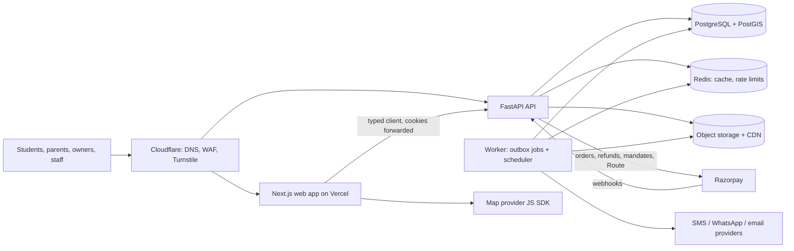

# Architecture and specs

How the platform is built. Read `PRODUCT_CONTEXT.md` first for the why. Sections 7 and 8 (booking, dynamic pricing) are the two pivots; get them right before anything fancy.

Contents
1. Principles
2. System overview
3. Stack
4. Repository layout
5. Backend design
6. Data model
7. Booking system (pivot)
8. Dynamic pricing engine (pivot)
9. Payments, refunds and ledger
10. Search, PG pages and the map
11. Visits
12. Identity and access
13. Media
14. Notifications
15. API conventions
16. Frontend architecture
17. Security
18. Scalability and performance
19. Observability
20. Testing strategy
21. Environments, CI/CD and deployment
22. Configuration and feature flags

---

## 1. Principles

- **Modular monolith, not microservices.** One API service and one worker, with strict module boundaries enforced by tooling. Modules can be split out later if a real need appears. No Kubernetes, no message broker, no event sourcing.
- **Engineered where it matters, simple elsewhere.** Money, inventory, auth and personal data get rigorous design, database-level guarantees and heavy testing. Content pages and admin screens stay plain.
- **The database guards the invariants.** Double-booking is impossible because of an exclusion constraint, not because of application code. Ledger balance and idempotency are enforced with constraints and unique keys.
- **Pure domain core.** Pricing rules, the booking state machine and money maths are pure functions with no I/O, so they are easy to test exhaustively.
- **Ports and adapters for every external service** (payments, maps, SMS, WhatsApp, email, storage), each with a dev/test adapter, so vendors can change and tests never call the internet.
- **The server is the source of truth for every price and amount.** The frontend displays quotes; it never computes money.
- **Secure by default, observable by default, 12-factor.**

## 2. System overview



- The browser talks to the web app for pages and directly to the API (same parent domain, `api.<domain>`) for client-side calls. Session cookies are scoped to the parent domain.
- The worker runs the same codebase with a different entrypoint: it processes outbox jobs and runs scheduled jobs.
- Webhooks are verified, stored and acknowledged fast, then processed by the worker.

## 3. Stack

| Layer | Choice | Why |
|---|---|---|
| API | Python 3.12+, FastAPI, Pydantic v2 | A founder already works in FastAPI; typed; OpenAPI out of the box |
| ORM / migrations | SQLAlchemy 2 (async, asyncpg), Alembic, GeoAlchemy2 | Mature, explicit transactions, PostGIS types |
| Database | PostgreSQL 16+ with `postgis`, `btree_gist`, `pg_trgm`, `citext` | Geo queries, exclusion constraints, fuzzy search in one database |
| Cache / rate limits | Redis protocol: Valkey locally, ElastiCache for Valkey expected in production (ADR 0008) | Simple, fast; nothing durable lives only in Redis |
| Jobs | Outbox table + worker using `SELECT … FOR UPDATE SKIP LOCKED`; scheduler in the worker | Jobs are enqueued in the same transaction as the change that caused them; no broker to run |
| Python tooling | uv, ruff (incl. security rules), mypy strict, import-linter, pytest, pytest-asyncio, hypothesis, testcontainers, schemathesis, polyfactory | Fast, strict, testable |
| Web | Next.js (App Router), React, TypeScript strict | SSR/ISR for SEO pages, one app for public site, owner dashboard and ops console |
| UI | Tailwind CSS, shadcn/ui (Radix primitives) | Accessible components we own |
| Client data | TanStack Query; typed client from OpenAPI (`openapi-typescript` + `openapi-fetch`) in `packages/api-client` | End-to-end types, no hand-written fetch code |
| Forms / URL state | React Hook Form + Zod; nuqs for search filters in the URL | Shareable searches, validated forms |
| Web testing | Vitest, Testing Library, MSW, Playwright, axe-core, Lighthouse CI | Unit to E2E, accessibility and performance budgets |
| Maps | Google Maps Platform via `@vis.gl/react-google-maps` behind a `MapProvider` interface; MapLibre GL + Ola Maps as the alternative adapter | See section 10 |
| Payments | Razorpay behind a `PaymentGateway` port | Orders, refunds, UPI one-time mandates, Route split settlement |
| Monitoring | Sentry (web + API), OpenTelemetry traces, structured JSON logs (structlog), product analytics (PostHog, PII masked: personless events through the web server's `/api/events` and the API's outbox; ADR 0035) | |
| Hosting | Vercel (web, Mumbai functions region); AWS ap-south-1 Mumbai for API/worker (ECS Fargate), RDS PostgreSQL, Redis, S3 + CloudFront; Cloudflare DNS/WAF/Turnstile; Terraform | Low latency for Delhi users, managed services |

Use current stable versions and pin them. Verify third-party APIs against official docs at integration time.

## 4. Repository layout

```
.
├── CLAUDE.md
├── Makefile                       # one entry point for every command
├── .claude/                       # Claude Code settings, rules, skills
├── .github/                      # workflows/ (ci.yml, security.yml, deploy-*.yml later), renovate.json5
├── docs/                          # product context, architecture, build plan, adr/, runbooks/
├── infra/
│   ├── docker-compose.yml         # postgres+postgis, valkey (redis), seaweedfs (s3), mailpit
│   ├── postgres/                  # Dockerfile: PostgreSQL 18 + PostGIS 3.6 (amd64 and arm64)
│   └── terraform/                 # added in Phase 8
├── packages/
│   └── api-client/                # src/generated/ is GENERATED from OpenAPI — never edit by hand
└── apps/
    ├── api/
    │   ├── pyproject.toml  uv.lock  alembic.ini  Dockerfile  .env.example
    │   ├── migrations/
    │   ├── src/app/
    │   │   ├── main.py            # app factory
    │   │   ├── worker.py          # worker entrypoint (jobs + scheduler)
    │   │   ├── config.py          # pydantic-settings
    │   │   ├── core/              # db, redis, errors, logging, telemetry, security, idempotency,
    │   │   │                      # ratelimit, outbox, money, clock, ids, pagination, audit, flags
    │   │   └── modules/
    │   │       ├── identity/      # OTP, sessions, users, roles, consent
    │   │       ├── geo/           # cities, localities, campuses, metro stations, distances
    │   │       ├── catalog/       # owners, properties, room categories, rooms, beds, verification
    │   │       ├── media/
    │   │       ├── search/        # search, map pins, price summaries
    │   │       ├── pricing/       # domain/engine.py (pure), rules, bands, policies, quotes, calendar
    │   │       ├── visits/
    │   │       ├── booking/       # domain/state_machine.py (pure), allocations, holds, check-in, disputes
    │   │       ├── payments/      # ports.py, adapters/razorpay.py, webhooks, reconciliation, refunds
    │   │       ├── ledger/        # accounts, postings, invoices
    │   │       ├── owners/        # owner-facing APIs, agreements
    │   │       ├── ops/           # staff-facing APIs
    │   │       ├── notifications/ # ports + adapters: sms, whatsapp, email
    │   │       └── compliance/    # grievances, data requests, retention jobs
    │   └── tests/                 # unit/, integration/, contract/, load/ (k6)
    └── web/
        ├── package.json  next.config.ts  .env.example
        ├── messages/              # en-IN.json (typed translations)
        ├── src/proxy.ts           # per-request CSP nonce (Next.js 16's middleware)
        ├── src/app/               # routes (see section 16)
        ├── src/features/          # search, map, property, visits, booking, pricing, owner, ops
        ├── src/components/        # ui/ (shadcn), layout/, shared
        ├── src/lib/               # api client wrapper, auth, money formatting, analytics, flags, security, monitoring
        ├── src/config/brand.ts    # the ONLY place the brand name and colours live
        └── tests/                 # unit/, e2e/
```

## 5. Backend design

### Layers inside a module
```
router.py      HTTP only: parse, authorize (via policies), call service, map errors. No business logic.
service.py     Use cases. Owns the transaction. Calls domain functions, repositories, ports, outbox.
domain/        Pure Python: entities, value objects, rules, state machines. No FastAPI, SQLAlchemy, I/O, or now().
repository.py  SQLAlchemy queries for this module's tables only.
models.py      SQLAlchemy models.   schemas.py  Pydantic request/response models (extra="forbid").
policies.py    Authorization rules: can(actor, action, resource) -> bool.
```
- Enforce with import-linter: `domain` imports nothing from `core.db`, FastAPI or other modules' repositories; modules call each other only through services or domain events.
- Cross-module side effects go through **domain events written to the outbox** in the same transaction (e.g., `booking.activated` → ledger posting and owner invoice; `pricing.rules_changed` → recompute price summaries).

### Core building blocks (`core/`)
Built in step 0.4; ADR 0010 records the design choices.
- `money.py`: paise as `int`, basis points as `int`, exact half-up rounding (ties away from zero), rounding to steps, Indian digit grouping for logs. No floats anywhere. Pure.
- `clock.py`: the injectable clock, the only code allowed to read the system time (ruff enforces); `FrozenClock` lets tests stop and move time. `calendar.py` turns moments into dates in India (pure).
- `ids.py`: internal `bigint` identity keys; public UUIDv7 `public_id` in all APIs; human booking codes (8 chars, Crockford base32, e.g. `BK-7F3K2Q9M`), normalised when typed (case, spaces, O/0, I/L/1). Pure.
- `outbox.py`: `enqueue(session, kind, payload, *, clock, run_at=None, dedupe_key=None)` in the caller's transaction. Workers claim with `FOR UPDATE SKIP LOCKED` under a lease (5 min), so a dead worker's job is taken over. A handler's work and the job's done mark commit together. Failures retry with exponential backoff and jitter (10 s doubling to 1 h) and go `dead` after `max_attempts` (10), with an error log and metrics. Done jobs are kept 7 days, dead ones 30. Every handler is idempotent.
- `scheduler.py`: periodic jobs (`Every(interval)`, `DailyAt(time)` in India time) enqueued per slot with the dedupe key `schedule:<name>:<slot>`, so any number of workers run each slot once. `app/jobs.py` lists every handler and schedule.
- `idempotency.py`: `Idempotency-Key` support built into the service's own transaction rather than middleware. The key, scope (user), route, request hash and response are stored for 24 h. A retry replays the stored response (`Idempotent-Replayed: true`), concurrent duplicates run the work once, a rollback releases the key, and the same key with a different request → 422.
- `errors.py`: RFC 9457 problem+json with a stable machine `code`.
- `ratelimit.py`: Redis sliding-window limits per IP, user, phone or route, computed atomically in Lua with the injectable clock's time. Subjects are stored only as HMAC digests. Each limit fails open or closed when Redis is down; over the limit → 429 with `Retry-After`.
- `audit.py`: append-only audit log for staff, owner and money actions, written in the action's transaction. A trigger refuses UPDATE, DELETE and TRUNCATE.
- `flags.py`: typed feature flags (`Flag`), defaults in code, overrides in `feature_flags`, cached per process for ≤ 30 s; a bad value or an unreachable database falls back to the default.
- `hashing.py`: keyed digests (HMAC with `SECRET_KEY`) for personal data that must be matched but not stored.
- `geometry.py`: points, bounds, great-circle distances and the NCR sanity box (pure); `postgis.py`: geography values in, coordinates and distances out (ADR 0021).
## 6. Data model

All tables have `id bigint generated always as identity`, `created_at`, `updated_at`; user-visible rows also have `public_id uuid unique`. Money columns end in `_paise` (`bigint`, `CHECK (>= 0)` unless noted). Rates are basis points (`_bps`). Times are `timestamptz` (UTC). Move-in/out are `date` (Asia/Kolkata).

**Identity**
- `users` (phone_e164 unique, email citext unique null, name, college_or_workplace, gender `female | male | other` null: only to show PGs someone can stay in, status), `user_roles` (user_id, role: `student | parent | owner | field_agent | ops | admin`).
- `otp_challenges` (public_id, phone_e164, purpose, code_hash, attempts, requested_at, expires_at, consumed_at, superseded_at, ip_address, user_agent).
- `sessions` (public_id, user_id, token_hash, kind, started_at, last_seen_at, expires_at, absolute_expires_at, rotated_at, ended_at, end_reason, ip_address, user_agent).
- `user_identities` (user_id, provider `google`, subject, email citext, last_used_at; unique (provider, subject) and (user_id, provider)): a staff member's linked Google account.
- `totp_credentials` (user_id unique, salt, confirmed_at, last_used_step): a staff member's authenticator app. The secret itself is derived from `SECRET_KEY` and the salt, never stored.
- `consents` (user_id, purpose `account | marketing`, notice_version, granted_at, withdrawn_at; one active consent per purpose and version): every grant kept, withdrawal sets `withdrawn_at`.

**Geo** (reference data, ADR 0020)
- `cities` (slug, name, center geography(Point)), `localities` (city_id, slug, name, center geography(Point), boundary geography(MultiPolygon) null), `campuses` (city_id, slug, name, location geography(Point)), `metro_lines` (slug, name, colour, wikidata_id), `metro_stations` (slug, name, location geography(Point), wikidata_id), `metro_station_lines` (station_id, line_id): an interchange is on several lines.
- Every row keeps the OpenStreetMap element its coordinates came from (`osm_type`, `osm_id`). Slugs are the public keys.
- Coordinates come from OpenStreetMap through `make geo-refresh` and are never typed in; each station's lines come from Wikidata. The rows are loaded from `apps/api/src/app/modules/geo/data/places.json` by `python -m app.manage geo load`, never edited through the API.

**Catalog**
- `owners` (public_id, user_id, legal_name, business_name, gstin null, kyc_status: `not_started | pending | verified | rejected`, payout_account_ref null, agreement_version null, status: `active | suspended`).
- `owner_agreements` (owner_id, version, document_sha256, accepted_at, accepted_ip, accepted_user_agent): append-only, so the database refuses updates, deletes and truncation; one row per version an owner accepted (ADR 0025).
- `properties` (public_id, owner_id, slug, name, description, address_line, locality_id, `location geography(Point,4326)` exact, `display_location geography(Point,4326)` public, `location_precision: exact | approximate`, gender_policy: `boys | girls | coed`, meals: `none | breakfast | two | three | four`, house_rules, verification_status: `unverified | scheduled | verified | rejected | suspended`, licence_status: `unknown | applied | licensed | not_required`, licence_number null, society_permission: `n/a | on_file | missing`, instant_confirm bool, status: `draft | published | paused | delisted`, published_at: first listed). Draft → published ⇄ paused, any → delisted, delisted → draft; publishing needs an active room category with an active bed (ADR 0021).
- `room_categories` — **the sellable unit and the pricing unit** (public_id, property_id, occupancy: `single | double | triple | quad`, ac bool, attached_bath bool, balcony bool, label, `base_rent_paise` (listed rent per bed per month), `owner_min_rent_paise` null, `owner_max_rent_paise` null, security_deposit_paise, mandatory_charges jsonb (typed in paise: monthly, metered with a monthly estimate, or one-time), status: `active | inactive`). The database checks base > 0, owner min ≤ base ≤ owner max, and deposit ≥ 0 as the domain does.
- `rooms` (public_id, room_category_id, label, floor), `beds` (public_id, room_id, label, status: `active | inactive`). Labels are unique per category and per room; a room holds no more beds than its occupancy.
- `amenities` (slug, name; seeded by a data migration, slugs permanent), `property_amenities`; `verification_visits` (public_id, property_id, agent_id, scheduled_by, scheduled_for, status: `scheduled | submitted | cancelled`, status_before; the report: submitted_at (server time), position geography(Point) and position_accuracy_m from the agent's phone, distance_m from the pin, checklist jsonb, result: `passed | failed`, notes; cancelled_at, cancel_reason; one booked visit per property) and `verification_photos` (visit_id, media_asset_id, position) (ADR 0024).

**Inventory**
```sql
CREATE TABLE inventory_allocations (
  id          bigint GENERATED ALWAYS AS IDENTITY PRIMARY KEY,
  public_id   uuid NOT NULL UNIQUE,
  bed_id      bigint NOT NULL REFERENCES beds(id),
  period      daterange NOT NULL,            -- [move_in, move_out); an open end: until further notice
  kind        text NOT NULL CHECK (kind IN ('booking','offline_tenant','maintenance')),
  booking_id  bigint NULL REFERENCES bookings(id),   -- the foreign key arrives with bookings (5.3)
  is_active   boolean NOT NULL DEFAULT true,
  note        text NOT NULL DEFAULT '',
  created_by  bigint NULL REFERENCES users(id),
  ended_at    timestamptz NULL, ended_by bigint NULL REFERENCES users(id),
  created_at  timestamptz NOT NULL DEFAULT now(),
  CHECK (NOT isempty(period) AND NOT lower_inf(period)),
  CHECK ((kind = 'booking') = (booking_id IS NOT NULL)),
  EXCLUDE USING gist (bed_id WITH =, period WITH &&) WHERE (is_active)
);
```
This constraint is the double-booking guarantee. Never work around it. The inventory module owns the table; other modules read free beds and occupancy through its lookup, and ops place and end offline-tenant and maintenance blocks (ADR 0044).

**Pricing**
- Policy tables are versions in force from `effective_from` until `effective_to`: a change ends the current one and adds the next, and a gist exclusion constraint keeps versions from overlapping (per locality and occupancy for bands). Admins change them; each change is audited (ADR 0036).
- `fee_policies` (rate_bps = 3000, basis = `listed_rent`, gst_rate_bps = 1800, gst_mode: `exclusive | inclusive`, effective_from, effective_to).
- `booking_policies` (token_paise = 200000, hold_minutes = 15, free_cancel_days = 7, check_window_hours = 24, confirm_deadline_hours = 12, no_show_days = 3, late_cancel_policy: `refund_full | forfeit_to_owner | split`, max_active_holds_per_user = 1, max_advance_days = 120).
- `pricing_caps` (max_premium_bps = 4000, max_discount_bps = 3000, rounding_step_paise = 5000).
- `rent_bands` (locality_id, occupancy, min_rent_paise, max_rent_paise, source: `official | internal`, reference, effective_from, effective_to).
- `pricing_rule_sets` (property_id, version int, status: `draft | active | archived`, created_by, activated_at); unique (property_id) where status = 'active'. Active and archived sets are immutable: triggers refuse changing their rules, moving a set back, and deleting one that isn't a draft (ADR 0038).
- `pricing_rules` (rule_set_id, kind, room_category_ids bigint[] null (= all), params jsonb validated per kind, label shown to students, enabled).
- `price_quotes` (public_id, user_id null, room_category_id, move_in, stay_months, base_rent_paise, monthly_rent_paise, adjustments jsonb, clamps jsonb, fee_paise, gst_paise, owner_fee_total_paise, token_paise, due_at_move_in_paise, deposit_paise, mandatory_charges jsonb, rule_set_id, fee_policy_id, rent_band_id null, engine_version, inputs_sha256, expires_at).
- `pricing_alerts` (public_id, kind: `rent_below_market | clamps_frequent | rule_churn`, key unique, property_id, room_category_id null, details jsonb, raised_at, resolved_at, resolved_by, resolution): ops' integrity alerts, each raised once by its key (ADR 0043).
- `property_price_summaries` (property_id, room_category_id, month date, min_rent_paise, max_rent_paise, available_beds, occupancy, ac, attached_bath, computed_at) — feeds search and the map. Owned by the search module: one row per category with a bed to sell and month, for this month and the next six. Each month's range is the least and most the engine quotes for a move-in on any day of it still to come, for an 11-month stay (ADRs 0027, 0028, 0042).
- `search_listings` (property_id, public_id, slug, name, locality, `display_location` only, gender_policy, meals, verified, licensed, amenities, media_ids, published_at, generated full-text and trigram columns) — the search module's read model of listings the public can find, kept from the catalog's events (ADR 0028).

**Visits and booking**
- `visits` (public_id, property_id, student_id, preferred_slots tstzrange[], scheduled_slot tstzrange null, status: `requested | scheduled | completed | no_show | cancelled`, agent_id null, agent_checkin_at, agent_checkin_gps, outcome, booking_id null).
- `bookings` (public_id, code unique, student_id, property_id, room_category_id, bed_id, owner_id, quote_id, channel: `on_spot | remote`, visit_id null, move_in, stay_months, planned_move_out, status, hold_expires_at, confirmed_at, checked_in_at, check_window_ends_at, activated_at, cancelled_at, cancelled_by, cancellation_kind, completed_at, monthly_rent_paise, fee_paise, gst_paise, owner_fee_total_paise, token_paise, due_at_move_in_paise, version int).
- `booking_events` (booking_id, event, from_status, to_status, actor_type, actor_id, payload jsonb) — append-only; powers the student timeline and audits.
- `disputes` (booking_id, reason: `not_as_shown | unsafe | other`, description, media_ids, status: `open | resolved_refund | resolved_uphold`, resolved_by, resolved_at, notes).

**Payments and ledger**
- `payments` (public_id, booking_id, purpose: `token | rent | owner_invoice`, mode: `payment | upi_mandate`, provider, provider_order_id, provider_payment_id, provider_mandate_id, amount_paise, status, idempotency_key unique).
- `payment_events` (provider, provider_event_id, event_type, payload jsonb, signature_valid, received_at, processed_at, error) — **unique (provider, provider_event_id)**.
- `refunds` (payment_id, amount_paise, reason, provider_refund_id, status, requested_by, approved_by).
- `ledger_accounts` (code, name, type: `asset | liability | revenue | expense`), `ledger_transactions` (kind, booking_id, payment_id, memo), `ledger_entries` (transaction_id, account_id, direction: `debit | credit`, amount_paise > 0). Sum of debits = sum of credits per transaction, enforced by a deferred constraint trigger and tests.
- `owner_invoices` (owner_id, booking_id, invoice_number unique per financial year, fee_paise, gst_paise, total_paise, token_applied_paise, balance_due_paise, status: `draft | issued | paid | void`, issued_at, pdf_key).

**Platform**
- `outbox_jobs`, `idempotency_keys`, `audit_logs` (append-only; the app's DB role has no UPDATE/DELETE on it), `feature_flags`, `notifications`, `grievances` (ticket_number `GR-…`, user_id when signed in, name, phone or email, category, details, status `received | acknowledged | resolved`, acknowledge_by (48 h), resolve_by (a calendar month), acknowledged_at, reply, resolved_at, resolution; ADR 0034), `data_requests` (public_id, user_id, kind `export | deletion`, status `received | ready | expired | completed | rejected`, requested_at, resolved_at, expires_at, resolved_by, note; one open request per kind and person), `data_exports` (data_request_id, content: the export's JSON until it expires).

**Indexes to create from day one**: GiST on `properties.location` and `display_location`; GiST exclusion index above; trigram GIN on `properties.name` and `localities.name`; btree on every FK; partial index on `bookings (status, hold_expires_at) WHERE status = 'HELD'`; `outbox_jobs (status, run_at)`; BRIN on `booking_events.created_at` and `audit_logs.created_at`.

## 7. Booking system (pivot)

### 7.1 Flow
1. Student picks a room category and move-in date on a PG page; the web app requests a **quote**.
2. Student taps Reserve → `POST /v1/bookings` with `quote_id` and an `Idempotency-Key`. The API creates a **HELD** booking, allocates a free bed, and returns the payment step.
3. Student secures the token (payment or UPI block). The verified gateway event moves the booking to **TOKEN_SECURED**.
4. Owner or ops confirm (or the property auto-confirms) → **CONFIRMED**. The student now sees the exact address and move-in instructions.
5. On move-in the student taps "I've moved in" → **CHECKED_IN**, starting the 24-hour check window.
6. No dispute within the window → **ACTIVE**: the token is earned, the owner invoice is issued, ledger entries are posted.
7. At move-out → **COMPLETED**.

The same flow serves both channels: `on_spot` (student at the property with an agent, usually instant-confirm) and `remote` (behind the flag `remote_booking_enabled`).

### 7.2 State machine
Implemented as a pure transition table in `booking/domain/state_machine.py`. Services call `transition(booking, event, actor, now) -> (new_state, side_effects)` and persist with a compare-and-set update (`UPDATE … WHERE id = :id AND status = :expected AND version = :v`).

| From | Event | To | Actor | Guard | Side effects |
|---|---|---|---|---|---|
| — | `hold` | HELD | student | valid unexpired quote owned by user; bed free; active holds < limit; move_in within limits | allocation active; `hold_expires_at = now + hold_minutes`; create order or mandate request |
| HELD | `token_secured` | TOKEN_SECURED | system | verified gateway event; amount = quote token | ledger: token received; notify owner and ops; auto-`confirm` if `instant_confirm` |
| HELD | `hold_expired` | EXPIRED | system | now ≥ hold_expires_at | deactivate allocation; cancel order/mandate |
| HELD | `cancel` | CANCELLED | student | — | deactivate allocation |
| TOKEN_SECURED | `confirm` | CONFIRMED | owner, ops | — | notify student with exact address and move-in details |
| TOKEN_SECURED | `reject`, `confirm_timeout` | REJECTED | owner, ops, system | — | deactivate; full refund/release; suggest similar PGs |
| TOKEN_SECURED | `cancel` | CANCELLED | student | — (not yet confirmed) | deactivate; full refund/release |
| CONFIRMED | `cancel` | CANCELLED | student | today ≤ move_in − free_cancel_days | deactivate; full refund/release |
| CONFIRMED | `cancel_late` | CANCELLED | student | inside the cutoff | deactivate; apply `late_cancel_policy` |
| TOKEN_SECURED, CONFIRMED | `owner_cancel` | CANCELLED | owner, ops | — | deactivate; full refund/release; flag owner; rebooking help |
| CONFIRMED | `check_in` | CHECKED_IN | student; or ops, then student confirms | today ≥ move_in − 1 | `check_window_ends_at = now + check_window_hours` |
| CONFIRMED | `no_show` | NO_SHOW | system | today > move_in + no_show_days | deactivate; apply `late_cancel_policy` |
| CHECKED_IN | `dispute` | DISPUTED | student | now < check_window_ends_at | open dispute with photos; alert ops |
| CHECKED_IN | `window_elapsed` | ACTIVE | system | now ≥ check_window_ends_at | earn/capture token; issue owner invoice; ledger postings |
| DISPUTED | `resolve_refund` | REFUNDED | ops | — | deactivate; full refund/release; rebooking help |
| DISPUTED | `resolve_uphold` | ACTIVE | ops | — | as `window_elapsed` |
| ACTIVE | `move_out` | COMPLETED | owner, ops, student | — | truncate allocation period to the move-out date |

Allocation is active in HELD, TOKEN_SECURED, CONFIRMED, CHECKED_IN, DISPUTED, ACTIVE and COMPLETED (truncated). Every transition writes a `booking_events` row and an audit entry. Test every allowed transition and assert every other (state, event) pair is rejected.

The machine (ADR 0045) takes the booking's facts, the event, who sent it, the moment and the booking's own terms. It answers the next status with side-effect descriptors, or refuses with 409 `INVALID_TRANSITION`. Where the table leaves room, it takes the stricter reading:
- **Check-in:** ops may mark a move-in, but only the student's confirmation sends `check_in`.
- **Confirm:** the system sends `confirm` only as an instant-confirm PG's auto-confirmation.
- **The owner's deadline:** a secured token sets it for `confirm_deadline_hours`.
- **A late payment (§7.4):** it is `late_payment_revive` when the bed is free, and `late_payment_refund` when it isn't. After a refund the booking stays EXPIRED.
- **Move-out:** it is recorded once its day has come.

### 7.3 Holding a bed without race conditions
Inside one transaction:
1. `SELECT b.id FROM beds b JOIN rooms r ON r.id = b.room_id WHERE r.room_category_id = :c AND b.status = 'active' FOR UPDATE OF b` (serialises attempts per category).
2. Expire stale holds for these beds: set HELD bookings past `hold_expires_at` to EXPIRED and deactivate their allocations.
3. Choose a bed with no active allocation overlapping `[move_in, planned_move_out)`. Prefer beds in partly occupied rooms, so whole rooms stay free for groups.
4. Insert the booking (HELD) and the allocation. If the exclusion constraint fires anyway, return `409 BED_UNAVAILABLE`.

Required test: 50 concurrent hold requests for the last free bed → exactly one HELD booking, 49 × 409, no overlapping active allocations.

### 7.4 Edge cases (must be handled and tested)
- **Payment after the hold expired**: if the bed is still free, re-allocate and move to TOKEN_SECURED (`late_payment_revive`); otherwise refund automatically and notify the student with alternatives.
- **Duplicate or out-of-order webhooks**: processing is idempotent per `provider_event_id` and per payment status; states only move forward.
- **Quote expired at hold time**: `409 QUOTE_EXPIRED`; the client re-quotes and shows any price change before retrying.
- **Owner marks a bed occupied offline** while a hold exists: the offline block insert fails with the constraint; the owner sees which booking holds the bed.
- **Move-in beyond mandate validity** (UPI mode): use payment mode or ask the student to book closer to move-in.
- **Stay extension**: update the allocation's upper bound in a transaction (the constraint re-checks).

### 7.5 Scheduled jobs (worker)
| Job | Every | Does |
|---|---|---|
| expire_holds | 1 min | HELD past expiry → EXPIRED |
| confirm_timeouts | 5 min | TOKEN_SECURED past the deadline → REJECTED + refund |
| check_windows | 5 min | CHECKED_IN past the window → ACTIVE |
| no_shows | daily 10:00 IST | CONFIRMED past move_in + N days → NO_SHOW |
| reconcile_payments | 15 min | Fetch status of payments stuck in created/authorized |
| search.refresh_listing | on `catalog.listing_changed` and `catalog.inventory_changed` + nightly 00:30 IST | Refresh a listing's search entry and `property_price_summaries`; the nightly `search.refresh_all` queues every listing once a day (ADR 0027, 0028) |
| pricing.check_integrity | nightly 01:00 IST | Raise rents more than 25% below their market (resolving those no longer below) and last week's PGs whose quotes a limit held back more than 20% of the time; rule churn is checked as rules go into force (ADR 0043) |
| inventory.allocations_changed | on a block placed, ended or cancelled | Refresh the PG's search entry, free beds and prices, and revalidate its pages (ADR 0044) |
| search.reprice_listing | on `pricing.rules_changed` (the PG), `pricing.band_changed` (its locality's PGs) and `pricing.caps_changed` (every PG, once per caps version) | Reprice a listing's `property_price_summaries` from the engine and revalidate its pages (ADR 0042) |
| retention | daily 03:30 IST | `compliance.retention`: apply the retention schedule (`RETENTION_RULES` in `app/jobs.py`) and record what each rule removed (ADR 0018) |

All jobs are idempotent and emit metrics (processed, failed, lag).

## 8. Dynamic pricing engine (pivot)

### 8.1 Contract
`pricing/domain/engine.py` exposes one pure function:
```python
def quote(ctx: PricingContext) -> QuoteResult: ...
```
`PricingContext` holds: room category (base rent, owner min/max, occupancy type), property, move_in, stay_months, today, occupancy for the category on move_in (from real allocations), the active rule set, rent band (optional), fee policy, booking policy, pricing caps and `engine_version`. No I/O and no clock reads inside the engine.

### 8.2 Rule kinds (v1, set by owners/ops by hand)
| Kind | Params (validated per kind) | Effect |
|---|---|---|
| `season` | start_md, end_md (MM-DD, may wrap the year), bps | + or − bps when move_in falls in the range; seasons may not overlap for the same categories |
| `occupancy` | tiers: [{min_occupancy_bps, bps}] | Premium from the highest tier reached. Occupancy counts beds in TOKEN_SECURED or later plus offline tenants; **HELD beds don't count**, so holds can't inflate prices |
| `early_bird` | min_days_before, bps (negative) | Discount when booked far enough ahead |
| `last_minute` | max_days_before, max_occupancy_bps, bps (negative) | Discount close to move-in when occupancy is low |
| `length_of_stay` | tiers: [{min_months, bps (negative)}] | Discount from the highest tier reached |
| `override` | start, end, rent_paise | Fixed monthly rent for move-ins in range; skips other rules, still clamped |

Each rule has a `label` shown to students ("Peak season", "Early-bird").

### 8.3 Algorithm
```
base = category.base_rent_paise
if an override matches move_in:
    candidate = override.rent_paise; adjustments = [override]
else:
    premium  = min(sum of positive bps from matching rules, caps.max_premium_bps)
    discount = min(sum of |negative| bps from matching rules, caps.max_discount_bps)
    candidate = base * (10_000 + premium - discount) / 10_000        # integer maths, half-up
lo = max(owner_min or 0, band.min or 0); hi = min(owner_max or ∞, band.max or ∞)
if lo > hi: raise PricingConfigError  # surface to ops; never quote
price = round_to_step(clamp(candidate, lo, hi), step)  # then re-snap inside [lo, hi]
fee   = round_half_up(base * fee_policy.rate_bps / 10_000)            # ALWAYS on base
if gst_mode == exclusive: gst = round_half_up(fee * gst_rate_bps / 10_000); owner_total = fee + gst
else: owner_total = fee; net = round_half_up(fee * 10_000 / (10_000 + gst_rate_bps)); gst = fee - net
token = min(booking_policy.token_paise, price)
due_at_move_in = price - token
```
Worked example (₹10,000 base, July move-in, +15% season, −5% early-bird, 11-month stay −7%): premium 1,500, discount 1,200 → ₹10,300 → rounded to ₹10,300 (step ₹50) → fee ₹3,000, GST ₹540, owner total ₹3,540, token ₹2,000, due at move-in ₹8,300.

### 8.4 Quotes and the price lock
- `POST /v1/quotes` runs the engine and stores a `price_quotes` row (valid 30 minutes) with the full breakdown, versions and an `inputs_sha256`.
- Bookings copy the quote's money fields; that monthly rent holds for the whole stay. Rule changes create a new rule-set version and never touch existing quotes or bookings.
- The response includes a human explanation: "Base ₹10,000 · Peak season +15% · Early-bird −5% · 11-month stay −7% = ₹10,300/month, fixed for your stay".

### 8.5 Price calendar and honest urgency
- `GET /v1/properties/{slug}/price-calendar?from=…&weeks=12&stay=11` runs the engine for weekly move-in dates and returns each room's rent per week and its free beds (cached five minutes, and revalidated when the PG's rules go into force; ADRs 0040, 0042).
- The PG page shows "Move in by 15 Jun: ₹9,500 · from 1 Jul: ₹11,000". Text like "price rises on 1 Jul" is allowed only because the calendar proves it.
- "Only N beds left" appears only when real availability for the chosen dates is ≤ 3.
- No countdown timers except the real hold expiry during checkout.

### 8.6 Owner and ops pricing editor
- Edit a draft rule set, see validation errors (overlapping seasons, a band conflict, caps), preview any move-in date and stay with the full breakdown, see a 12-week price chart, then activate. Activation creates an immutable version and is audit-logged.
- Show the locality band and the market median next to the inputs.
- `GET /v1/ops/rule-sets/{id}/preview` prices any version as a quote made today would, up to a year ahead, nothing stored; `GET /v1/ops/rule-sets/{id}/calendar` is its weekly chart; `GET /v1/ops/properties/{id}/market` gives each room's band, the locality's median listed rent and the caps (ADR 0041).

### 8.7 Integrity guards
- The listed rent must be the price charged when no rule applies. Alert ops when it is more than 25% below the locality median for the same occupancy type, or when clamps trigger on more than 20% of quotes in a week.
- `pricing_alerts` holds these, and rules activated more than three times in a week, each raised once; ops read and resolve them at `GET /v1/ops/pricing-alerts` and `POST /v1/ops/pricing-alerts/{id}/resolve` (ADR 0043).
- Caps and bands are admin-only settings.

### 8.8 Invariants (property-based tests with Hypothesis, ≥ 10,000 generated cases in CI)
- `fee` depends only on base rent and fee policy, never on rules, occupancy or dates.
- `price` stays within [lo, hi] whenever lo ≤ hi, and is a multiple of the rounding step (unless the bounds force otherwise).
- Total premium ≤ cap and total discount ≤ cap.
- Early-bird, last-minute and length-of-stay rules never raise a price; occupancy premiums apply only at or above their threshold.
- Same inputs → same output; all amounts are non-negative integers; `due_at_move_in + token = price`.

### 8.9 Later (Phase 9, after a season of data)
Suggested prices for owners from demand signals: PG page views, visit requests and conversion per locality and week, occupancy pace against last year, and the calendar. Owners approve every suggestion; nothing changes prices automatically.

## 9. Payments, refunds and ledger

### 9.1 Port
```python
class PaymentGateway(Protocol):
    async def create_order(self, *, amount_paise: int, receipt: str, notes: dict[str, str]) -> Order: ...
    def verify_checkout_signature(self, *, order_id: str, payment_id: str, signature: str) -> bool: ...
    def verify_webhook(self, *, raw_body: bytes, signature: str) -> bool: ...
    async def fetch_payment(self, payment_id: str) -> PaymentStatus: ...
    async def refund(self, *, payment_id: str, amount_paise: int, idempotency_key: str) -> Refund: ...
    # capability: UPI one-time mandate (token block)
    async def create_mandate(self, *, amount_paise: int, expires_at: datetime, ...) -> Mandate: ...
    async def capture_mandate(self, mandate_id: str, amount_paise: int) -> Capture: ...
    async def release_mandate(self, mandate_id: str) -> None: ...
    # capability: split settlement (Razorpay Route), Phase 9
    async def transfer(self, *, payment_id: str, account_ref: str, amount_paise: int, on_hold: bool) -> Transfer: ...
    async def release_transfer(self, transfer_id: str) -> None: ...
```
Adapters: `RazorpayGateway` and `FakeGateway` (deterministic, used in tests and local dev, can emit signed webhook fixtures).

### 9.2 Token modes (`token_mode` flag)
- `payment` (v1 default): server creates an order for exactly `quote.token_paise`; Razorpay Checkout on the web; the server verifies the checkout signature, but **only the verified webhook or a server-side fetch moves the booking**. Refund on cancel, reject, timeout or dispute.
- `upi_mandate` (after Razorpay enables one-time mandates for us): authorise a block for the token; capture on ACTIVE; release on refund paths. Validity must cover move_in + check window.
- `rent_via_app` (Phase 9): the student pays the rest of the first month through the app; Route transfers `rent − owner_fee_total` to the owner's linked account.

Verify Razorpay's current docs for order creation, checkout signature format, webhook headers and event names, OTM and Route before writing the adapter.

### 9.3 Webhooks
`POST /v1/webhooks/razorpay`: read the raw body → verify HMAC with the webhook secret → insert into `payment_events` (unique provider event id; a duplicate returns 200 and stops) → enqueue `process_payment_event` → return 200 within 1 s. The worker maps events to payment status changes and booking transitions, idempotently. Unknown events are stored and ignored.

### 9.4 Ledger
Chart of accounts (seeded): `gateway_clearing` (asset), `bank` (asset), `owner_receivable` (asset), `student_tokens_held` (liability), `owner_payable` (liability, Phase 9), `gst_payable` (liability), `placement_fee_revenue` (revenue), `payment_fees` (expense).

| Event | Debit | Credit |
|---|---|---|
| Token captured | gateway_clearing 2,000 | student_tokens_held 2,000 |
| Token refunded | student_tokens_held 2,000 | gateway_clearing 2,000 |
| Booking ACTIVE: invoice owner | owner_receivable 3,540 | placement_fee_revenue 3,000; gst_payable 540 |
| Booking ACTIVE: apply token | student_tokens_held 2,000 | owner_receivable 2,000 |
| Owner pays the balance | gateway_clearing 1,540 | owner_receivable 1,540 |
| Gateway fee | payment_fees | gateway_clearing |
| Settlement to bank | bank | gateway_clearing |

Amounts shown in rupees for the ₹10,000 example. Every money-moving use case posts its entries in the same transaction as the state change. The accounting treatment must be confirmed with a CA; the ledger design supports changes.

### 9.5 Owner invoices
Issued on ACTIVE: fee, GST, token applied, balance due; sequential invoice numbers per financial year (`FY2027-28/000123`); a PDF stored privately; balance collected through a Razorpay payment link and marked paid by webhook.

### 9.6 Reconciliation
Every 15 minutes, check payments stuck in created/authorized. Daily, match gateway settlement reports against the ledger; any mismatch raises an alert and a ticket. A reconciliation dashboard is part of the ops console.

## 10. Search, PG pages and the map

### 10.1 Search API
`GET /v1/search/properties` with: `campus` + `radius_m` or `locality` or `bbox`; `move_in_month`; `budget_min`/`budget_max` (against `property_price_summaries` for that month); `gender`; `occupancy`; `meals`; `ac`; `attached_bath`; `amenities[]`; `verified_only` (default true); `available` (beds free for the month); `q` (trigram + full-text on name and locality); `sort`: `recommended | price_asc | price_desc | distance | newest`; cursor pagination (max 50). Returns cards: name, locality, display location, distance to the chosen campus and nearest metro, price range for the month, badges (verified, licensed, meals), cover photo variants, beds-available bucket. Built on the search module's read model and the price summaries, kept from the catalog's events; distances from display points; keyset cursors that carry the order; `SEARCH_INVALID` for a search that can't be answered (ADR 0028).

### 10.2 Map pins API
`GET /v1/map/pins?bbox=w,s,e,n&zoom=&…same filters` → up to 2,000 compact pins `{id, lat, lng, minRent, maxRent, gender, verified, availability}` using `display_location`. Cached in Redis by rounded bbox, zoom and a filter hash (60 s), with ETags. Clustering happens on the client. The area is snapped outwards to a quarter-tile grid for the zoom, so small pans share cache entries; `truncated` says more than 2,000 matched; `If-None-Match` gets a 304; pins come from the database while Redis is down (ADR 0029).

### 10.3 The map experience (showcase)
- **Price pins** like "₹8k–12k" (verified PGs get a badge); clusters show the count and the lowest price.
- Desktop split view (list + map); mobile shows the list first with a map toggle and a draggable bottom sheet.
- "Search as I move the map": debounce 300 ms, cancel stale requests, keep results in the URL so searches are shareable.
- Hovering a card highlights its pin and vice versa; selecting a pin opens a preview card.
- Overlays: campuses as dots, with the chosen campus's name and its 1 km and 2 km rings; metro stations; the selected locality's outline once localities have boundaries (until then the map shows 1.5 km around its centre, ADR 0031). They come from OpenStreetMap, so the map credits "© OpenStreetMap contributors" with a link to openstreetmap.org/copyright, next to the map provider's own attribution (ADR 0020).
- The map is locked to Delhi NCR bounds and zoom levels.
- Keyboard and screen reader users get the same results through the list; pins are focusable.
- Load the map SDK lazily, only when the map view is opened.

### 10.4 Provider choice
- Default: **Google Maps Platform** (strongest India map data). Google announced India pricing up to 70% lower and up to US$6,800 a month of free usage across products from March 2025, with Maps Embed API usage free and unlimited ([Google, Dec 2024](https://blog.google/intl/en-in/products/explore-communicate/helping-developers-in-india-build-more-with-google-maps-platform/)). Use the JS API only on the search map, and the free Embed API for the small map on PG pages.
- Alternative adapter: **MapLibre GL + Ola Maps** tiles: 100,000 free map loads a month, then ₹0.141 per load, from 1 September 2026 ([Ola Maps pricing](https://maps.olakrutrim.com/pricing)). Check MapLibre compatibility in their docs.
- Prefer providers that show India's official boundaries; the NCR lock keeps country borders off-screen anyway.
- Re-check prices and quotas before launch and set budget alerts in the provider console.

### 10.5 Location privacy
- `display_location` is the exact point shifted by a random bearing and 80–150 m, generated once and stored (regenerated only if the exact point changes), so repeated requests can't be averaged to find the building.
- Distances shown to the public are measured from the display point too: exact distances to a few known places would give the building away by trilateration (ADR 0021).
- The exact address and pin are shown only after a visit is scheduled or a booking is confirmed (flag `hide_owner_contact`).
- The public read (`GET /v1/properties/{slug}`) never loads the exact point, the address or the owner's account. The contact details come from `/v1/properties/{slug}/contact`, for someone signed in, while the flag is off or once they're entitled; each look is audited. Public listing text can't carry a phone number, and a sweep test calls every public route looking for the address, the phone or a point near the building (ADR 0026).
- Field agents capture the exact location by GPS during verification; ops can adjust the pin manually.

### 10.6 PG page and SEO
- `/pg/[slug]` (ISR): gallery with "verified photo" labels, video tour, safety checklist summary, room categories with live prices for the chosen month, price calendar, amenities, house rules, deposit and mandatory charges, distance to campuses and metro, owner business name, reviews (later), "Book a visit" and "Reserve a bed" CTAs. Rendered per request with its CSP nonce from listing data cached across visitors (tagged for on-demand revalidation), every charge and the deposit upfront, the safety summary from the last passing visit, and the area as a circle around the display point (ADR 0030).
- Landing pages: `/pg-near/[campus]`, `/pg-in/[locality]` with real inventory, filters and FAQs. They're rendered on the server from `GET /v1/search/places` (each campus with verified live PGs within 3 km and each locality with some, with the count and the month's rents) and search's first page. A place without PGs says so and is `noindex` (ADR 0032).
- JSON-LD (`LodgingBusiness` with `Offer` price ranges), canonical URLs, `sitemap.xml`, `robots.txt`, dynamic Open Graph images. The API triggers on-demand revalidation when a listing or its prices change.
  - The structured data has the locality and the display point, never the address (§10.5).
  - The sitemap comes from `GET /v1/search/sitemap`, with each listing's last change as `lastmod`.
  - Revalidation: after each catalog event the worker posts the changed listing's cache tags to the web app's `/api/revalidate`, signed with `REVALIDATE_SECRET` (an HMAC of the time and the body, refused after five minutes), and the next visit fetches the data again (ADR 0032).

## 11. Visits

- Student requests a visit with up to three preferred slots; ops schedule it and assign an agent; SMS/WhatsApp confirmation and reminders at T−24 h and T−2 h.
- The agent checks in at the property from their phone (timestamp + GPS). That **visit log** proves we introduced the student (leakage defence).
- After the visit the agent records the outcome. If the student wants the bed, the agent opens **Reserve now** on the student's phone (channel `on_spot`) — quote → hold → token.
- Limits: at most 5 open visit requests per student; rate limits on creation.
- Built in step 3.7 (ADR 0033): the student offers 1 to 3 times (on the hour or half past, 9 am to 7 pm, 3 hours to 2 weeks ahead); ops book one with an agent at `/v1/ops/visits/{id}/schedule`; texts and reminders are outbox jobs through a `Texts` port (console locally; a provider is the founders' choice); the agent checks in at `/v1/field/visits/{id}/check-in` from two hours before, and an outcome needs that check-in. A booked visit entitles the student to the address (§10.5).

## 12. Identity and access

- **Students, parents, owners**: phone OTP (ADR 0015).
  - Codes: six digits, stored as an HMAC under `SECRET_KEY` bound to their challenge. A code expires after five minutes and allows five attempts (the sixth answers `OTP_LOCKED`). A new code replaces the old one, at most every 30 seconds.
  - Limits: at most five sends per phone per hour, plus per-IP limits (60 requests an hour, 120 checks per 15 minutes).
  - Turnstile: Cloudflare Turnstile runs before any send. A token counts only for the sign-in form's action (`otp_request`) and the web app's hostnames.
  - Phone numbers: Indian mobiles only, normalised to E.164 (+91).
  - Accounts: created at the first correct code. Responses never reveal whether a number has an account.
  - Sending: codes go out straight away, never through the outbox (which would store them), as SMS from a DLT-registered template behind an `OtpSender` port. `OTP_SENDER=console` logs them (local only); `unavailable` turns phone sign-in off (503) until the founders choose the provider.
  - Retention: challenges are deleted after 7 days.
- **Staff (ops, admin, field agents)** (ADR 0016):
  - Becoming staff: only an operator can make someone staff (`python -m app.manage staff add`, audited). Signing in with Google never grants a role.
  - Sessions: staff sessions last 12 hours from sign-in, and stop working once the user has no staff role. Staff roles come only with a staff session: a phone sign-in drops them, so a SIM swap can't reach the back office.
  - Google sign-in: OIDC (authorization code with PKCE, state and nonce; scope `openid email`) restricted to allowed Workspace domains (`STAFF_GOOGLE_DOMAINS`, checked against the `hd` claim) or exact addresses (`STAFF_GOOGLE_EMAILS`). 2-step verification is enforced by the Workspace.
    - The ID token's RS256 signature (Google's keys, cached), issuer, audience, expiry and nonce are all checked.
    - The sign-in keeps no server state: a 10-minute `__Host-staff-login` cookie holds a login id, and the state, nonce and PKCE verifier are HMACs of it.
    - The Google account is linked by its `sub` at the first sign-in.
  - Until the domain exists: a phone sign-in, then a TOTP code (RFC 6238; each code works once; five tries per 15 minutes) from an authenticator app enrolled only from the command line.
- **Sessions**: opaque 256-bit tokens; only their SHA-256 stored server-side; the `__Secure-session` cookie (`HttpOnly; Secure; SameSite=Lax`) on the parent domain (`SESSION_COOKIE_DOMAIN`); 30-day sliding expiry for users (moved at most every 10 minutes, with the cookie re-sent), 12 hours from sign-in for staff; signing in ends the browser's previous session, and `rotate()` renews the token on role changes; logout and "log out everywhere"; session list in the profile; ended sessions deleted after 30 days (ADR 0014).
- **CSRF**: SameSite=Lax plus a signed double-submit token: `GET /v1/auth/csrf` sets `__Secure-csrf`, and every POST, PUT, PATCH and DELETE must echo it in `X-CSRF-Token`. Tokens are HMAC-signed with `SECRET_KEY` and bound to the session cookie. An app-wide dependency enforces this (deny by default; provider webhooks exempt), and a test sweeps every route. CORS allowlist of exact origins.
- **Authorization** (ADR 0017): deny by default.
  - Routes get the actor from `app.core.current_actor`: `CurrentActor` answers 401 without a session, and `OptionalActor` gives None instead.
  - Policy functions in each module's `policies.py` decide, as pure `can_…(actor, facts) -> bool` functions. A role the session lacks answers 403 `FORBIDDEN`.
  - Services apply object-level policies: an owner only sees their properties and their bookings; a student only their visits and bookings. Another user's record answers 404, as if it didn't exist.
  - The authorization matrix (`apps/api/tests/authorization.py`) lists every route against eight kinds of caller, with the expected status. A unit test fails CI when a route has no entry, and an integration test calls every route as every caller.
- **Parents**: a signed, expiring, read-only share link for a PG and a booking; a parent can pay the token from the link without an account (Phase 9).
- **Consent (DPDP)** (ADR 0018):
  - Consent is per purpose (`account` required, `marketing` optional, never pre-ticked) and per privacy notice version (`PRIVACY_NOTICE_VERSION`; production refuses a draft).
  - A first sign-in creates no account without it (`CONSENT_REQUIRED`, with the code still usable). An account ops made for someone, an owner for instance, asks the same at its person's first sign-in (ADR 0025). `/v1/me` says `consentRequired` when the notice changes.
  - Data requests: exports are built by a job from every module's part and downloadable by their owner only, for 7 days. Deletions wait in the ops queue; the erasure policy is the founders' to decide.
  - The retention schedule is one daily job running every module's rules.

## 13. Media

- Direct-to-storage uploads with presigned POSTs that storage itself enforces: content-type allowlist per purpose (photos JPEG, PNG, WebP; video MP4; documents PDF, JPEG, PNG), size limits (photos 15 MB, video 200 MB, documents 10 MB), no SVG, no HEIC (ADR 0022). Every upload lands in the private bucket.
- The worker validates magic bytes, **strips all metadata including EXIF and GPS** (re-encoding every variant), creates WebP/AVIF variants (thumb 160, card 480, gallery 1080, full 2048 px) and marks moderation status. Video: remux without metadata (phones write the location there), a poster image, and a 3-minute limit (transcoding can come later). The original is deleted once processed.
- Public listing media are served through the CDN from the public bucket; private files (KYC, agreements, invoices, dispute photos, verification photos) use links signed for 5 minutes. `media_assets` holds each upload's purpose, status and variants.
- `verified_capture = true` marks photos taken by a field agent, shown as "Verified photo · 12 Jun 2027".

## 14. Notifications

- Ports: `SmsSender`, `WhatsAppSender` (later, through a BSP), `EmailSender`; dev adapters log to the console or Mailpit.
- Sent from outbox jobs, with a dedupe key per (event, recipient, channel). Templates are versioned and DLT-approved for SMS.
- Key messages: OTP, visit scheduled/reminder, booking held/secured/confirmed/rejected, check-in window started/ended, refund issued, owner new-booking alert, owner confirm reminder, invoice issued.

## 15. API conventions

- REST over JSON at `/v1`; plural nouns; JSON fields in camelCase (Pydantic alias generator), Python in snake_case.
- Errors: RFC 9457 problem+json `{type, title, status, detail, code, errors[], requestId, traceId}` (`app/core/errors.py`, ADR 0009). Each `errors[]` item is `{detail, code, pointer}` for a body field (JSON Pointer, e.g. `/moveIn`) or `{detail, code, parameter}` for a query, path or header parameter. Rejected input is never echoed back, and unexpected errors never reveal their message. Stable codes, e.g. `BED_UNAVAILABLE`, `QUOTE_EXPIRED`, `HOLD_LIMIT_REACHED`, `INVALID_TRANSITION`, `RATE_LIMITED` (429, with `Retry-After`), `PRICING_CONFIG_ERROR`. Sign-in: `OTP_INVALID`, `OTP_EXPIRED` and `OTP_LOCKED` (400), `OTP_RESEND_TOO_SOON` (429, with `Retry-After`), `HUMAN_CHECK_FAILED` (400), `ACCOUNT_SUSPENDED` (403). Staff sign-in: `STAFF_ACCOUNT_NOT_ALLOWED` (403, one code for every reason), `STAFF_SIGN_IN_EXPIRED` and `STAFF_SIGN_IN_CANCELLED` (400; Google sign-in sends these to the web app's `/staff/sign-in?error=`), `TOTP_INVALID` (400). Consent: `CONSENT_REQUIRED` (400), `PRIVACY_NOTICE_CHANGED` (409), `CONSENT_NEEDED_FOR_ACCOUNT` (409). Catalog: `LISTING_INVALID` (422, every problem in the detail), `LISTING_INCOMPLETE` (409: nothing to sell yet), `ROOM_FULL`, `LABEL_TAKEN` and `OWNER_EXISTS` (409: that phone's account is already an owner), `CONTACT_HIDDEN` (403: the owner's contact details show once a visit is scheduled or a booking confirmed; ADR 0026). Search: `SEARCH_INVALID` (422: a search that can't be answered, every problem in the detail; ADR 0028). Visits: `VISIT_INVALID` (422: times or a request that don't work, every problem in the detail), `VISIT_EXISTS` and `VISIT_LIMIT_REACHED` (409), `CHECK_IN_REQUIRED` and `CHECK_IN_TOO_EARLY` (409; ADR 0033). Policies: `POLICY_INVALID` (422: a version the founders' rules don't allow, every problem in the detail), `PRICING_CONFIG_ERROR` (503 when no version is in force; ADR 0036). Rule sets: `RULE_SET_INVALID` (422: a rule that can't be, or a set that can't go into force, every problem in the detail; ADR 0038). Quotes: `QUOTE_INVALID` (422: a move-in or stay that can't be quoted; in ops' preview, also a room whose limits leave no rent; ADR 0041). Inventory: `BED_UNAVAILABLE` (409: something holds the bed on one of those days, and the detail says what), `BLOCK_INVALID` (422: a block that can't be, every problem in the detail; ADR 0044), `QUOTE_EXPIRED` (409: past its 30 minutes; ADR 0039). Owner agreement: `AGREEMENT_CHANGED` (409: the version or text accepted isn't the current one; ADR 0025). Media: `MEDIA_NOT_ALLOWED` (422: a type or size the purpose doesn't take), `MEDIA_NOT_UPLOADED` (409). `INVALID_TRANSITION` (409) answers any state machine's refusal. Generic codes: `VALIDATION_ERROR` (422), `BAD_REQUEST`, `UNAUTHENTICATED` (401: no live session), `CSRF_TOKEN_INVALID` (403), `FORBIDDEN` (403: signed in, but the session lacks the role; another user's record answers `NOT_FOUND`), `NOT_FOUND`, `METHOD_NOT_ALLOWED`, `NOT_ACCEPTABLE`, `CONFLICT`, `PAYLOAD_TOO_LARGE` (bodies over 1 MiB), `UNSUPPORTED_MEDIA_TYPE`, `SERVICE_UNAVAILABLE`, `INTERNAL_ERROR`, and `HTTP_ERROR` for any other status. Idempotency: `IDEMPOTENCY_KEY_REQUIRED` and `IDEMPOTENCY_KEY_INVALID` (400), `IDEMPOTENCY_KEY_REUSED` (422), `IDEMPOTENCY_KEY_CONFLICT` (409).
- Probes: `GET /healthz` (liveness) and `GET /readyz` (database and Redis reachable, 503 otherwise) sit outside `/v1`, need no authentication, and are left out of tracing and info-level access logs.
- Money: integer paise with names ending in `Paise`; the client formats with `Intl.NumberFormat('en-IN', { style: 'currency', currency: 'INR' })`.
- Dates: `YYYY-MM-DD` for move-in; timestamps in ISO 8601 UTC; display in IST.
- Public ids only (UUIDv7, booking codes). Never expose sequential ids.
- Cursor pagination (`cursor`, `limit` ≤ 50, default 20; `app/core/pagination.py`). Lists are ordered by public id, which as a UUIDv7 sorts by creation time, so the cursor is the last id of the page; responses are `{items, nextCursor}`, with `nextCursor` null on the last page, and a page costs one query however many rows (ADR 0016). Reference data (the geo lists) comes whole instead, ordered by name the same way in every environment (ADR 0020).
- `Idempotency-Key` is required on POSTs that create bookings, payments, refunds or invoices.
- OpenAPI is the contract: CI regenerates the TS client and fails if it is stale; `oasdiff` fails CI on breaking changes. `make gen-client` exports the schema without starting the API (`python -m app.openapi`) into `packages/api-client/openapi.json` and generates `src/generated/schema.ts` with openapi-typescript; `make check-client` (part of `make check`) fails when either is out of date. Operation ids are the route's tag and function name in camelCase (`systemHealthz`), and every operation declares `4XX`/`5XX` as `application/problem+json` `ProblemDetail`, so the web client's error types are the API's real ones (ADR 0012).

Main endpoints (v1):
```
Public   GET  /v1/cities /v1/localities /v1/campuses /v1/campuses/{slug} /v1/metro-stations /v1/amenities
         GET  /v1/search/properties    GET /v1/map/pins
         GET  /v1/search/places        GET /v1/search/sitemap (ADR 0032)
         GET  /v1/properties/{slug}    GET /v1/properties/{slug}/contact (signed in; ADR 0026)
         GET  /v1/properties/{slug}/price-calendar   (ADR 0040)
         POST /v1/quotes               GET /v1/quotes/{id}   (ADR 0039)
Auth     POST /v1/auth/otp/request     POST /v1/auth/otp/verify   GET /v1/auth/csrf
         POST /v1/auth/logout   POST /v1/auth/logout-everywhere
         GET/PATCH /v1/me   GET /v1/me/sessions   DELETE /v1/me/sessions/{session_id}
         GET /v1/auth/staff/google   GET /v1/auth/staff/google/callback   POST /v1/auth/staff/totp
         GET /v1/privacy-notice   GET/POST /v1/me/consents   DELETE /v1/me/consents/{purpose}
Student  POST/GET /v1/visits           POST /v1/visits/{id}/cancel (ADR 0033)
         POST /v1/bookings             GET /v1/bookings   GET /v1/bookings/{code}
         POST /v1/bookings/{code}/cancel | /check-in | /disputes
         POST /v1/payments/{id}/checkout-callback
Webhooks POST /v1/webhooks/razorpay
Owner    GET /v1/owner/profile   GET /v1/owner/agreement   POST /v1/owner/agreement/acceptances   (ADR 0025)
         /v1/owner/properties… /v1/owner/beds/{id}/blocks /v1/owner/pricing/rule-sets… (+ /preview, /activate)
         /v1/owner/bookings/{code}/confirm | /reject   /v1/owner/invoices
Ops      /v1/ops/owners  /v1/ops/owners/{id} (GET, PATCH; + /agreements)   (ADR 0025)
         /v1/ops/properties… (+ /status /amenities /media /history /room-categories)
         /v1/ops/room-categories/{id} (+ /rooms)  /v1/ops/rooms/{id}/beds  /v1/ops/beds/{id}   (ADR 0023)
         /v1/ops/field-agents  /v1/ops/properties/{id}/verification-visits (GET, POST)
         /v1/ops/properties/{id}/verification/suspend  /v1/ops/verification-visits (agents: their own)
         /v1/ops/verification-visits/{id} (+ /report /cancel)   (ADR 0024)
         /v1/ops/visits… /v1/ops/bookings…
         /v1/ops/properties/{id}/rule-sets (+ /draft)   /v1/ops/rule-sets/{id} (+ /rules /activate)
         /v1/ops/rules/{id} (PUT, DELETE)   (ADR 0038)
Field    GET /v1/field/visits   GET /v1/field/visits/{id}   POST /v1/field/visits/{id}/check-in | /outcome
         /v1/ops/disputes… /v1/ops/refunds… /v1/ops/reconciliation
Admin    GET /v1/admin/policies (+ /history)   POST /v1/admin/policies/fee | /booking | /caps   (ADR 0036)
         GET/POST /v1/admin/rent-bands   POST /v1/admin/rent-bands/{id}/end   (ADR 0036)
         /v1/admin/staff /v1/admin/flags /v1/admin/audit-logs
Media    POST /v1/media   POST /v1/media/{id}/uploaded   GET /v1/media/{id}
Compliance POST /v1/grievances   GET /v1/me/grievances   (ADR 0034)
         POST/GET /v1/me/data-requests   GET /v1/me/data-requests/{id}/file
         GET /v1/ops/data-requests   POST /v1/ops/data-requests/{id}/resolve
         GET /v1/ops/grievances   GET /v1/ops/grievances/{ticket}   POST …/{ticket}/acknowledge | /resolve
Pricing  GET /v1/policies   (the fee and booking terms in force; ADR 0034)
Web      POST /api/events (the web server's own: browser analytics passed on to PostHog; ADR 0035)
```

## 16. Frontend architecture

- Route groups: `(marketing)` home, about, pricing, contact, legal pages; `(discover)` `/search`, `/pg/[slug]`, `/pg-near/[campus]`, `/pg-in/[locality]`; `(account)` login, profile; `(student)` `/visits`, `/bookings/[code]`; `/owner/*` dashboard; `/ops/*` console. Owner, ops and account routes are `noindex` and protected in `src/proxy.ts` (Next.js 16's name for middleware) **and** on the server.
- Server Components by default; Client Components for the map, filters, booking flow and editors.
- Signing in (ADR 0019):
  - The browser calls the API itself for every session change, so the API sets its own cookies (the site and the API must be one site). The web server only forwards them.
  - `getSession()` asks `/v1/me` once per page request, and not at all without a session cookie. The header shows Sign in, Your account or Staff tools.
  - `/account` and `/staff` redirect to their sign-in page with a `next` that can only be a path on this site.
  - The sign-in flow runs phone, code, consent (only when the API asks; nothing pre-ticked), then the profile, or the authenticator for staff. It ends with a full page load, so the layout's header picks up the new session.
- Data: server-side calls through the typed client with cookies forwarded; client-side through TanStack Query with conventional query keys; no ad-hoc `fetch`. `src/lib/api` wraps the generated client (openapi-fetch): `getServerApi()` forwards only the API's own cookies and the page's request id and gives up after 3 s; `browserApi` sends credentials; `unwrap()` turns error responses and failed requests into a typed `ApiError` (ADR 0012).
- The URL is the source of truth for search state (nuqs). Minimal global state. `/search` renders its first page of results on the server from the URL, then the browser takes over through TanStack Query; both libraries ship with that page only (ADR 0031).
- `MapProvider` interface: search's `<MapView pins selectedId hoveredId onBoundsChange onPinSelect onPinHover campuses chosenCampus stations initial target />` (ADR 0031), the PG page's `<LocationMap center radiusM />` (ADR 0030) and the ops console's `<PinPicker value onChange center />` (ADR 0023). MapLibre with raster tiles is the adapter: tiles are configuration (`NEXT_PUBLIC_MAP_TILES_URL` and its attribution), OpenStreetMap's servers for local development only, and no map where none is set up. A Google adapter waits for the founders, Google being a paid vendor.
- Feature folders own their components, hooks and tests; enforce boundaries with ESLint rules.
- Performance: dynamic import of the map; `next/image` with CDN variants; `next/font`; route-level code splitting; budget on mid-range Android over 4G of LCP < 2.5 s, INP < 200 ms, CLS < 0.1, initial JS < 200 KB gzip on PG pages.
- PWA: manifest, icons, a service worker for the app shell and the shortlist; never cache authenticated API responses.
- Accessibility: WCAG 2.2 AA; Radix primitives; visible focus; labels; colour contrast; axe checks in CI.
- i18n-ready from day one (strings in message files; English first, Hindi later). next-intl with typed keys; server components translate and client components receive plain strings, so the browser ships no message formatter unless a page needs client-side formatting (ADR 0011).
- Security headers: `src/proxy.ts` sets a per-request nonce CSP (pages render per request; step 3.4 revisits this for ISR); static headers live in `next.config.ts` (ADR 0011).
- Brand name, colours and logo only in `src/config/brand.ts`.

## 17. Security

Target OWASP ASVS level 2 for auth, booking, payments and personal data.

- **Input**: Pydantic and Zod validation; `extra="forbid"`; request size limits; server computes all money; quotes are server-side records, not client payloads.
- **Auth**: as section 12. Lock out after repeated OTP failures; alert on spikes.
- **Authorization**: policies on every endpoint; 404 for others' resources; the authorization matrix test must pass in CI.
- **Headers**: strict CSP with nonces (no `unsafe-inline` scripts), HSTS, `X-Content-Type-Options: nosniff`, `Referrer-Policy: strict-origin-when-cross-origin`, `frame-ancestors 'none'`, a tight `Permissions-Policy` (geolocation only on self, for "near me").
- **Payments**: never handle card data; amounts computed server-side; checkout signature verified; webhooks verified on the raw body; idempotent processing; refunds require the ops role, a reason and an audit entry; two-person approval for manual refunds above ₹5,000 (configurable).
- **Rate limits and abuse**: OTP, login, visit and booking creation, search and map endpoints; at most one active hold per user; Cloudflare WAF rules on auth routes; bot protection on public search to slow scraping.
- **Secrets**: environment variables loaded from AWS Secrets Manager / Vercel env; separate test and live keys; rotation documented; gitleaks in pre-commit and CI; nothing secret in `NEXT_PUBLIC_*`; Claude Code is denied read access to `.env` files.
- **Data protection**: managed encryption at rest; application-level envelope encryption for KYC fields and documents; minimal PII; mask phone numbers in logs (show the last 4 digits); no Aadhaar numbers; retention schedule; breach response runbook (DPDP).
- **Files**: see section 13 (presigned uploads, EXIF stripping, private buckets, no SVG).
- **Supply chain**: lockfiles with a 7-day release cooldown; Renovate (Dependabot lacks pnpm 12 and uv 0.13 support); pip-audit and pnpm audit with reviewed exceptions only; CodeQL (including the workflows); Trivy on images; GitHub Actions pinned by commit SHA and linted with actionlint and zizmor; scanners as digest-pinned containers; read-only workflow tokens; OIDC from CI to AWS (no long-lived keys). See docs/ci.md and ADR 0013.
- **Infrastructure**: no public database endpoint; least-privilege security groups and IAM; separate AWS accounts or projects for staging and production; automated backups with point-in-time recovery and a tested restore.
- **Audit**: append-only audit log for staff, owner and money actions; the app's DB role can't modify it.
- **Testing**: OWASP ZAP baseline on staging, Schemathesis fuzzing from the OpenAPI schema, a STRIDE threat model per phase that touches auth or money, and an external penetration test before scaling beyond the first micro-market.

## 18. Scalability and performance

- Planning load for peak season: 100,000 monthly users, 300 requests/s peak reads (search, map, PG pages), 20 requests/s writes, 50 concurrent hold attempts on one popular PG. Design for 10× by scaling horizontally.
- Stateless API and worker containers with autoscaling on CPU and latency; DB connection pooling (sized pools, RDS Proxy or PgBouncer when needed); a read replica for search when required.
- Caching: Redis for map pins, search results and price calendars with event-based invalidation; CDN for media and static assets; ISR for PG and landing pages.
- Precompute `property_price_summaries` so search and map never run the pricing engine per request.
- Query discipline: every list endpoint paginated; N+1 checks in tests (a query-count assertion helper); `EXPLAIN ANALYZE` on the top queries before launch.
- City as a first-class dimension (cities → localities → bands → policies) so Gurugram, Noida and later Bengaluru or Pune are configuration, not code.
- SLOs: p95 < 300 ms for search and map pins, < 400 ms for quote and hold (gateway time excluded), 99.9% monthly availability in June–August; zero double bookings.
- Load tests with k6 before every peak season and before major releases.

## 19. Observability

- Structured JSON logs with request id, user id (internal), route and latency; no PII; phone numbers masked.
- OpenTelemetry tracing across FastAPI, SQLAlchemy and httpx, exported to the chosen backend; trace ids returned in error responses.
- Metrics: bookings by state and transitions per hour, hold expiry rate, quote-to-hold and hold-to-secured conversion, webhook lag, outbox lag and dead jobs, reconciliation mismatches, OTP send failures, p95 latency per route, error rate.
- Sentry for web and API, with release tracking and source maps.
- Alerts: dead outbox jobs, webhook failures, reconciliation mismatch, error-rate spike, OTP provider failure, constraint violations above baseline, refund stuck > 24 h.
- Runbooks in `docs/runbooks/` for each alert.

## 20. Testing strategy

| Level | Tools | Must cover |
|---|---|---|
| Unit (pure domain) | pytest, Hypothesis | Pricing engine invariants; state machine (every pair); money maths; policies |
| Integration | pytest + testcontainers (PostGIS image) | Repositories, exclusion constraint, hold concurrency, outbox, webhooks with signed fixtures, ledger balance |
| Contract | schemathesis, oasdiff | API matches the schema; no breaking changes |
| Web unit | Vitest, Testing Library, MSW | Components, hooks, formatting |
| E2E | Playwright against a production build and the real API on its own database (`scripts/e2e-api.sh`, ADR 0019) (+ FakeGateway or Razorpay test mode on staging) | Search → map → PG page → visit; quote → hold → token → confirm → check-in → active; dispute → refund; owner pricing edit → calendar |
| Accessibility / performance | axe, Lighthouse CI | Key pages within budget |
| Load | k6 | Search, map pins, hold race |
| Security | authorization matrix, ZAP baseline, gitleaks, CodeQL | No regressions |

Coverage gates: ≥ 90% branches in `pricing`, `booking`, `payments` and `ledger`; ≥ 75% overall API; critical E2E flows must pass to merge.

## 21. Environments, CI/CD and deployment

- **Local**: `make dev` runs docker-compose (PostGIS, Valkey for Redis, SeaweedFS for S3, Mailpit), the API with reload, the worker, and Next.js; `make health` checks them all. `make seed` loads the geo reference data now (from OpenStreetMap, ADR 0020) and, with the catalog, realistic sample data (fictional PGs with plausible rents from PRODUCT_CONTEXT).
- **Staging**: same shape as production, smaller; Razorpay test keys; seeded data; preview deployments for web PRs. Give staging its own subdomains (e.g. `staging.<domain>` and `api.staging.<domain>`) so session cookies stay same-site; previews on `*.vercel.app` can't share them.
- **Production**: Razorpay live keys; manual approval for deploys; feature flags for risky features.
- **CI** (GitHub Actions, docs/ci.md): lint, typecheck, unit and integration tests (PostGIS and Valkey containers), web build, Playwright E2E on the build, client staleness, OpenAPI diff, workflow linting, security scans (also weekly); E2E against staging nightly and before releases once staging exists.
- **Migrations** run as a separate step before the new API version starts; expand → migrate data → contract; never edit applied migrations; every migration tested up and down in CI.
- **Reference data**: after migrations, `python -m app.manage geo load` whenever `places.json` changed. It writes only what differs (runbook: geo data).
- **Infra as code** with Terraform from Phase 8; until then document manual setup in `docs/runbooks/`.
- Keep costs low early: smallest instance sizes, no NAT gateway (public subnets with strict security groups) until needed, budget alerts on AWS, Vercel and the map provider.

## 22. Configuration and feature flags

- Secrets and infrastructure settings: environment variables (`.env.example` documents each one).
- The versions of legal texts in force: `PRIVACY_NOTICE_VERSION` (ADR 0018) and `OWNER_AGREEMENT_VERSION`, which names a file in `catalog/data/agreements` (ADR 0025). Production refuses either while it names a draft.
- Business policy (fees, tokens, windows, caps, bands): database tables with an admin UI and audit log — never constants in code.
- Feature flags (`feature_flags` table, cached ≤ 30 s): `remote_booking_enabled`, `token_mode` (`payment | upi_mandate`), `rent_via_app_enabled`, `hide_owner_contact`, `instant_confirm_default`, `reviews_enabled`, `whatsapp_enabled`, `price_suggestions_enabled`, `verified_only` (on: only verified PGs are published and searched; ADR 0024).
